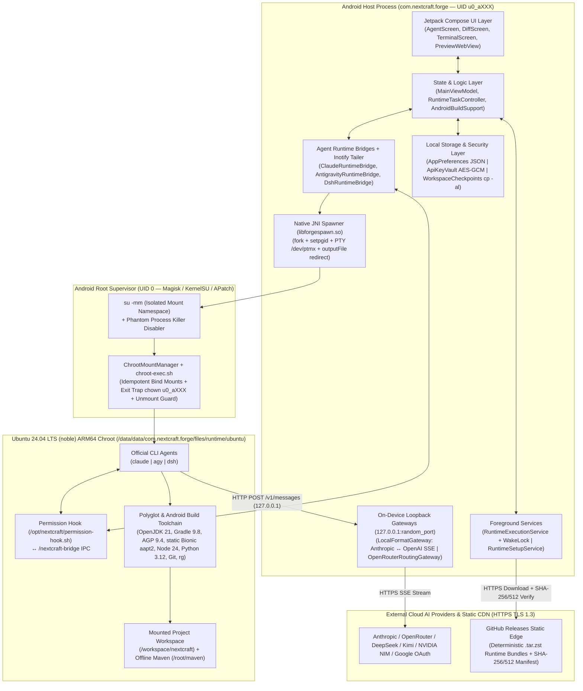

# NextCraft Forge (`com.nextcraft.forge`) — Master Engineering Blueprint (Fase 1 s/d Fase 7)

> **Identitas Proyek**: **NextCraft Forge** (`com.nextcraft.forge`) — Autonomous Mobile AI Coding IDE & Native Android Build System  
> **Basis**: NextCraft Forge (`com.nextcraft.forge`). Atribusi kode pihak ketiga: lihat [`THIRD_PARTY_NOTICES.md`](THIRD_PARTY_NOTICES.md).  
> **Mesin Runtime Tunggal**: **Pure Root Chroot (`su -mm` + Linux Kernel Mounts)** di atas **Ubuntu 24.04 LTS (`noble`) ARM64** (Tanpa PRoot / Tanpa Dual-Runtime)  
> **Strategi AI**: **Multi-Agent CLI Harness (`Claude Code`, `Antigravity CLI`, `DeepSeek Harness`) + Cloud AI Providers via On-Device Loopback Gateway** (Tanpa Local LLM Engine / Tanpa Fine-Tuning)  
> **Prinsip Dokumen**: **100% Faktual, Tanpa Placeholder, Tanpa Halusinasi**. Setiap bagian dari *Master Engineering Prompt (Fase 1 s/d Fase 7)* dieksekusi menggunakan arsitektur nyata **Zero-Cloud On-Device** NextCraft Forge di atas **Pure Root Chroot**.

---

## Pemetaan Paradigma: Template SaaS Cloud Umum vs Arsitektur Nyata NextCraft Forge

Sebelum masuk ke Fase 1–7, tabel berikut memetakan komponen standar pada template *Mobile AI Builder* umum ke komponen faktual yang ada di **NextCraft Forge**:

| Komponen pada Prompt Template | Mengapa Tidak Dipakai Mentah | Ekuivalen Faktual di **NextCraft Forge (`com.nextcraft.forge`)** |
| :--- | :--- | :--- |
| **Flutter (Dart) / React Native** | Butuh akses JNI level rendah ke PTY (`/dev/ptmx`), proses grup UNIX (`setpgid`), `FileObserver` (`inotify`), dan `PackageInstaller` Android. | **Android Native (Kotlin 2.x + Jetpack Compose Material 3 + C11 JNI `libforgespawn.so`)** |
| **Cloud Backend (Python FastAPI + Nginx)** | NextCraft Forge adalah aplikasi **100% Local-First / Zero-Cloud Backend** (tanpa biaya server bulanan). | **On-Device Loopback Gateway (`LocalFormatGateway.kt` & `OpenRouterRoutingGateway.kt` di `127.0.0.1:<random_port>`)** |
| **PostgreSQL + `pgvector` + Redis** | Membuka DB server & Vector DB di HP menghabiskan RAM; pencarian kode sumber jauh lebih presisi dengan pencarian leksikal langsung di filesystem. | **`AppPreferences.kt` (JSON), `ApiKeyVault.kt` (`AndroidKeyStore` AES-GCM), `WorkspaceCheckpoints.kt` (`cp -al` hardlink), & `ripgrep` (`rg`) di `/workspace/nextcraft`** |
| **Celery + Redis/RabbitMQ Workers** | Pekerjaan panjang (kompilasi Gradle, ekstraksi `.tar.zst`, eksekusi AI Agent) berjalan lokal di OS Android. | **Android Foreground Services (`RuntimeExecutionService.kt` & `RuntimeSetupService.kt`) + `PARTIAL_WAKE_LOCK` + Bypass Phantom Process Killer via `su`** |
| **Terraform AWS ECS + Docker ECR** | Tidak ada container cloud; kontainer adalah rootfs Ubuntu 24.04 lokal yang didistribusikan secara statis. | **Deterministic Rootfs Pipeline (`build-core-on-rooted-android.sh` + `create_deterministic_tar.py` + GitHub Releases Static Edge `manifest.json`)** |
| **Local LLM (`llama.cpp`) / Fine-Tuning (`LoRA`)** | Dihapus sesuai keputusan arsitektur: model lokal menguras RAM/baterai yang dibutuhkan oleh kompilasi Gradle/Kotlin. | **Cloud API Providers (`Anthropic`, `OpenRouter`, `DeepSeek`, `Kimi`, `NIM`) + Official CLI Agents (`claude`, `agy`, `dsh`)** |

---

## FASE 1 — Discovery & Problem Scoping

### 1.1 Problem Statement Document

* **User Pain Point**:
  Developer Android dan full-stack engineer yang memiliki perangkat flagship Android ber-chipset ARM64 kencang (Snapdragon 8 Gen 2/3/Elite, RAM 8–16 GB) dan akses **Root (`Magisk` / `KernelSU` / `APatch`)** tidak dapat memanfaatkan performa hardware mereka secara penuh untuk menjalankan agen coding otonom (*Claude Code*, *Antigravity CLI*, *DeepSeek Harness*) sekaligus mengompilasi proyek Android (`Gradle assembleDebug`) secara lokal.
* **Current Solution & Mengapa Tidak Cukup**:
  1. **Pendekatan PRoot**: Sudah memiliki UI Chat, Diff Viewer, dan integrasi CLI Agent yang matang, tetapi menggunakan **`libproot.so`** (`ptrace` syscall interception) di atas **Ubuntu 20.04 (`focal`)**. Setiap syscall `stat()`, `openat()`, dan `execve()` selama kompilasi Gradle/Kotlin harus melewati *context switch* user-space berkali-kali, sehingga kompilasi menjadi **3x–8x lebih lambat** dibanding kernel native, dan pustaka `glibc 2.31` di Ubuntu 20.04 mulai usang untuk binary CLI modern.
  2. **Termux + `chroot` Manual**: Memberikan kecepatan native, tetapi sama sekali tidak memiliki UI Mobile IDE terpadu—tidak ada *Streaming Thinking/Tool Card UI*, tidak ada *Side-by-Side Diff & 1-Tap Undo/Keep Checkpoint*, tidak ada *Loopback API Format Translator* (`Anthropic` $\leftrightarrow$ `OpenAI`), dan tidak ada *1-Tap APK Build & Install*.
  3. **Cloud IDE (GitHub Codespaces / Replit)**: Wajib online 100%, memiliki latensi input tinggi saat sinyal seluler buruk, dan membebankan biaya sewa VM per jam.
* **Proposed Solution (**NextCraft Forge**)**:
  Membangun aplikasi Android native (`com.nextcraft.forge`) yang menggabungkan seluruh keunggulan UX dan orkestrasi multi-agen dari agent app berbasis PRoot dengan **Single-Engine Pure Root Chroot (`su -mm` + Linux kernel bind mounts)** di atas **Ubuntu 24.04 LTS (`noble`) ARM64**. Seluruh operasi file, eksekusi CLI Agent (`claude`, `agy`, `dsh`), dan kompilasi Gradle di `/workspace/nextcraft` berjalan dengan **100% kecepatan kernel native (0% overhead `ptrace`)**, dilengkapi *inotify streaming*, *hardlink workspace checkpoints*, *silent root APK installer*, dan *root package-scoped logcat debugger*.
* **Explicitly Out of Scope (v1.0)**:
  1. **Dukungan Non-Root / PRoot (`libproot.so`)**: Dihapus total demi menjaga kode C/JNI (`libforgespawn.so`) dan manajemen mount tetap ramping, cepat, dan bebas *dual-runtime bug*.
  2. **On-Device Local LLM Inference (`llama.cpp` / `GGUF`) & Model Fine-Tuning (`LoRA` / `QLoRA` / `RLHF`)**: Dihapus total agar seluruh RAM perangkat (8–16 GB) didedikasikan untuk daemon kompilasi `Gradle`/`Kotlin`/`aapt2` dan CLI Agent.
  3. **iOS App & Cloud Backend Milik Sendiri**: Aplikasi hanya menargetkan Android ARM64 (`arm64-v8a`) dengan arsitektur *100% Zero-Cloud Backend*.

---

### 1.2 Target User Persona

| Atribut | Persona 1: **Arka — Rooted Android Modder & Indie App Creator** | Persona 2: **Raka — On-the-Go Full-Stack & AI Engineer** | Persona 3: **Dina — Security Researcher & Open-Source Maintainer** |
| :--- | :--- | :--- | :--- |
| **Peran & Konteks** | Pengembang aplikasi Android independen yang mem-build dan menguji APK langsung di HP/tablet utama tanpa membawa laptop. | Engineer yang sering bepergian (commuter/traveler) dan perlu memperbaiki bug, me-review PR, serta men-deploy web/API menggunakan *Claude Code* / *Antigravity CLI*. | Peneliti keamanan & kontributor open-source yang membutuhkan lingkungan Ubuntu 24.04 ARM64 berakses root penuh dengan kontrol git/diff ketat. |
| **Technical Proficiency** | **5 / 5** (Paham `KernelSU`/`Magisk`, `adb`, `gradle`, `logcat`). | **4 / 5** (Mahir Git, Node.js, Python, dan prompt engineering AI Agent). | **5 / 5** (Mahir Linux internals, `chroot`, network debugging, dan bash). |
| **Primary Use Case & Frekuensi** | Menjalankan AI Agent untuk membuat fitur Jetpack Compose, menjalankan `assembleDebug` offline, menginstal APK 1-tap, dan membaca crash logcat (**Harian, 2–4 jam/hari**). | Menjalankan `Claude Code` dengan provider OpenRouter/DeepSeek untuk refactoring repo Git dan melihat live preview di WebView (**Harian, 1–2 jam/hari**). | Menguji kode di kontainer Ubuntu 24.04, menginstal paket `apt` modern, dan memeriksa setiap perubahan file AI lewat tab *Changes (Diff)* (**4–5x seminggu**). |
| **Device & Spesifikasi Tipikal** | POCO F5 / Xiaomi 14 / OnePlus 12 (Snapdragon 8 Gen 2/3, RAM 12 GB, UFS 4.0, Rooted dengan `KernelSU`). | Samsung Galaxy Tab S9 / Fold 5 (Snapdragon 8 Gen 2, RAM 12 GB, layar besar/lipat, Rooted dengan `Magisk`). | Google Pixel 8 Pro (Tensor G3, RAM 12 GB, Android 15/16, Rooted dengan `APatch`). |
| **Ekspektasi Latency** | Cold-start perintah Chroot **$\le 300\text{ ms}$**; streaming token pertama (**TTFB**) **$\le 1.5\text{ detik}$**; incremental APK build **$\le 25\text{ detik}$**. | Transisi antar tab (Chat $\leftrightarrow$ Diff $\leftrightarrow$ Preview) **$\le 16\text{ ms}$ (60/120 fps)**; streaming chunk UI **$\le 10\text{ ms}$**. | Ekstraksi bundel rootfs `.tar.zst` **$\le 45\text{ detik}$**; snapshot checkpoint sebelum agen jalan **$\le 100\text{ ms}$**. |
| **Penggunaan Offline?** | **Ya (Sering)**: Wajib bisa mengedit kode, menjalankan `git`, dan mengompilasi APK (`gradle --offline`) saat tanpa internet. | **Parsial**: Butuh internet untuk API LLM, tetapi butuh baca riwayat chat, diff kode, dan jalankan local dev server secara offline. | **Ya**: Memakai varian APK `offline` (dengan bundel `.tar.zst` tertanam) agar bisa setup kontainer tanpa internet. |

---

### 1.3 Competitive Analysis Matrix

| Kompetitor / Solusi | Core AI Capability | Streaming UX | Offline Support | Customization Level | Pricing Model | API Availability | Exploitable Gap untuk **NextCraft Forge** |
| :--- | :--- | :--- | :--- | :--- | :--- | :--- | :--- |
| **ChatGPT / Claude Official Mobile App** | Hanya Chat & Cloud Sandbox terbatas (tidak bisa akses filesystem proyek lokal atau build APK). | Sangat halus (native SSE), tetapi tidak menampilkan *inline file diff* atau kontrol proses lokal. | Hanya baca cache chat lama; tidak bisa eksekusi kode offline. | Rendah (terkunci pada 1 vendor, tidak bisa BYOK lintas provider). | Langganan ($20–$200/bln). | Tidak bisa menghubungkan API key kustom di dalam aplikasi mobile resmi. | Tidak memiliki kontainer Linux lokal, tidak bisa menjalankan CLI Agent di repo lokal, dan tidak bisa mem-build APK. |
| **Termux + `chroot` / `proot-distro`** | Tidak ada integrasi AI bawaan (user harus install & konfigurasi CLI manual di layar terminal kecil). | Hanya teks terminal ANSI mentah; sulit membaca diff file atau menyetujui *tool call* di layar sentuh. | Penuh (100% lokal), namun tanpa Offline Gradle Maven bundle siap pakai. | Sangat tinggi via skrip shell, tetapi UX mobile buruk. | Gratis (Open Source). | Bebas (konfigurasi manual via variabel `export` di `.bashrc`). | Tidak ada GUI Chat, tidak ada *Side-by-Side Diff + Undo Checkpoint*, tidak ada *LocalFormatGateway* (`Anthropic` $\leftrightarrow$ `OpenAI`). |
| **GitHub Codespaces / Replit Mobile** | AI Copilot / Replit Agent berjalan di server cloud. | Sering lag saat koneksi seluler tidak stabil; terminal berbasis WebSocket sering putus saat pindah aplikasi. | **Nol (0%)** — aplikasi mati total jika tidak ada koneksi internet. | Terbatas pada VM cloud yang disewa. | Pay-as-you-go / Langganan ($10–$50+/bln). | Mendukung secret environment di cloud. | Biaya bulanan mahal, wajib online terus-menerus, dan tidak bisa langsung menginstal serta men-debug APK di HP tempat aplikasi berjalan. |
| **Agent app berbasis PRoot** | Multi-Agent CLI (`Claude Code`, `Antigravity CLI`, `DSH`) + Loopback Gateway multi-provider. | Bagus (Thinking accordion, Tool cards, Diff viewer), namun pembacaan stream masih memakai *polling* `delay(80)`. | Sangat baik (Offline Maven repo & varian APK `offline`). | Tinggi (8 provider AI, OAuth & BYOK, custom base URL). | Gratis / BYOK (Bring Your Own Key / Subscription). | Mendukung `ANTHROPIC`, `OPENROUTER`, `OPENAI_CHAT`, `OPENAI_RESPONSES`. | **Masih memakai `PRoot` (`libproot.so`) di atas Ubuntu 20.04**, sehingga kompilasi Gradle lambat akibat overhead `ptrace`, proses root tidak terkelola, dan `glibc 2.31` sudah tua. |
| **NextCraft Forge (`com.nextcraft.forge`)** | **Multi-Agent CLI (`claude`, `agy`, `dsh`) berjalan di Pure Root Chroot Ubuntu 24.04 LTS ARM64.** | **Real-time `inotify` (`FileObserver`) stream (<2ms latency) + Native Diff Viewer + Root Logcat Crash Catcher.** | **100% Offline Gradle Build + Hardlink Checkpoints (`cp -al`) + Offline `.tar.zst` Bundles.** | **Penuh: Root Chroot penuh, 8+ AI Providers, API Key Pool, Custom System Prompts.** | **100% Gratis & Open/BYOK (User memakai API Key / OAuth sendiri tanpa biaya tengah).** | **Loopback Gateway lokal menerjemahkan Anthropic Messages API ke OpenAI/OpenRouter secara transparan.** | **Menutup gap performa PRoot: 3x–8x lebih cepat di I/O & kompilasi berkat Pure Kernel Chroot + Ubuntu 24.04 LTS.** |

---

### 1.4 KPI & Success Metrics

| Kategori | Metrik | Target (PRoot Baseline $\rightarrow$ **NextCraft Forge Target**) | Metode Pengukuran di Aplikasi |
| :--- | :--- | :--- | :--- |
| **Runtime Performance** | Cold-Start Chroot Execution Latency | $1.800\text{ ms}$ (PRoot) $\rightarrow$ **$\le 350\text{ ms}$ (P95)** | `ForgeMetricsTracker.measureChrootSpawnMs()` |
| **Streaming UX** | Local Stream Tail Latency (JSONL write $\rightarrow$ Compose UI state) | $80\text{ ms}$ (Polling) $\rightarrow$ **$\le 5\text{ ms}$ (P95 via `inotify`)** | Timestamp delta antara `FileObserver.MODIFY` dan `StateFlow` emission |
| **Build Speed** | Incremental Android APK Build (`assembleDebug --offline`) | $75\text{ detik}$ (PRoot) $\rightarrow$ **$\le 22\text{ detik}$ (P95)** | `AndroidBuildProgressTracker` stage duration timer |
| **Setup Speed** | Ekstraksi Bundel Rootfs (`core` + `android` ~950 MB `.tar.zst`) | $360\text{ detik}$ (JVM Tar) $\rightarrow$ **$\le 45\text{ detik}$ (Native `zstd \| tar`)** | `RuntimeInstaller` setup stopwatch |
| **Memory & Stability** | Host JVM Heap Usage & Crash-Free Session Rate | **$\le 220\text{ MB}$ RAM** & **$\ge 99.5\%$ Crash-Free** | `BoundedFileReads` (cap 256 KB) + `RootfsRepair` atomic swap guard |
| **Quality & Safety** | Checkpoint Undo Recovery Success Rate | **100% lossless rollback** dalam **$\le 150\text{ ms}$** | Verifikasi SHA-256 file sebelum & sesudah `WorkspaceCheckpoints.restore()` |

---

### 1.5 Cost, Quota & BYOK Architecture (Zero-Middleman Model)

Berbeda dengan aplikasi SaaS yang menarik biaya langganan untuk mem-proxy API di server mereka, **NextCraft Forge** mengadopsi arsitektur **100% Direct Bring-Your-Own-Key (BYOK) & Direct OAuth Subscription**:

1. **Tiga Mode Akses Provider (Tanpa Biaya Tengah)**:
   - **Tier A — Direct OAuth Subscription (`CLAUDE` Pro/Max & `Antigravity` Google OAuth)**: Pengguna login menggunakan akun langganan resmi mereka melalui alur PTY OAuth (`AntigravityAuthController.kt` & Claude OAuth). Token disimpan di dalam kontainer chroot (`/root/.claude` atau `/root/.gemini`) dengan izin ketat `0600`.
   - **Tier B — Multi-Key BYOK Pool (`ApiKeyVault.kt`)**: Pengguna dapat memasukkan **banyak API Key sekaligus** (*API Key Pool*) untuk satu provider (`Anthropic`, `OpenRouter`, `DeepSeek`, `Kimi`, `NVIDIA NIM`, `OpenCode Zen`, `Custom`). Jika Key #1 terkena HTTP `429 Rate Limit` atau kehabisan saldo (`402`/`quota_exceeded`), sistem secara otomatis merotasi ke Key #2 di dalam pool.
   - **Tier C — Free Model Discovery (`ProviderApiClient.discoverModels`)**: Untuk pengguna tanpa modal, fitur *Auto Model Discovery* memfilter model dengan harga `$0 / token` (`isFree == true`, seperti model `:free` di OpenRouter atau endpoint trial NVIDIA NIM).
2. **Local Token & Character Budget Guard (`RuntimeBridge.kt`)**:
   - Kuota dikendalikan langsung di perangkat pengguna melalui `recentWithinCharacterBudget(maxCharacters = 96_000)` dan pembatasan pembacaan log `BoundedFileReads.kt` ($256\text{ KB}$) sehingga agen tidak pernah membakar token secara tidak sengaja akibat membaca file log raksasa.

### Definition of Done Fase 1
- [x] Problem statement terdokumentasi dengan jelas (mengapa Pure Chroot Ubuntu 24.04 menggantikan PRoot Ubuntu 20.04).
- [x] 3 persona pengguna perangkat Android Rooted terdokumentasi lengkap dengan spesifikasi dan target latensi.
- [x] Competitive analysis matrix membandingkan 5 solusi nyata dan memetakan celah keunggulan NextCraft Forge.
- [x] KPI & metrik teknis kuantitatif ditetapkan (Cold-start $\le 350\text{ ms}$, stream tail $\le 5\text{ ms}$, incremental build $\le 22\text{ s}$).
- [x] Arsitektur BYOK, OAuth, API Key Pool rotation, dan Free Model Discovery terdokumentasi.

---

## FASE 2 — Architecture Decisions & Tech Stack

### 2.1 Architecture Decision Records (ADR-001 s.d. ADR-006)

#### ADR-001: Mobile Platform & Native Execution Bridge Selection
* **Status**: Accepted
* **Context**: NextCraft Forge harus mengelola terminal PTY (`/dev/ptmx`), melakukan `fork()`/`execve()` dengan pengaturan grup proses (`setpgid`), memantau perubahan file kontainer via kernel `inotify`, menjalankan reverse proxy HTTP/SSE lokal, dan memanggil `PackageInstaller` Android.
* **Options**:
  1. *Flutter (Dart)*: UI lintas platform yang baik, tetapi membutuhkan lapisan MethodChannel ganda (Dart $\rightarrow$ Kotlin $\rightarrow$ JNI C) yang menambah latensi streaming dan menyulitkan manajemen lifecycle `ForegroundService` Android.
  2. *React Native (TypeScript)*: Overhead JSI/Bridge tinggi saat menerima ribuan event JSONL per detik dari CLI Agent dan rawan kehabisan memori saat mem-parsing diff file besar.
  3. *Android Native (Kotlin 2.x + Jetpack Compose Material 3 + C11 JNI `libforgespawn.so`)*: Akses langsung (zero-overhead) ke API sistem Android, Java NIO `FileChannel`, `FileObserver`, dan JNI C11.
* **Decision**: Memilih **Option 3 — Android Native (Kotlin 2.x + Jetpack Compose + C11 JNI `libforgespawn.so`)**.
* **Consequences**:
  - **Positif**: Performa UI 60/120fps stabil, ukuran APK ramping, integrasi langsung dengan `AndroidKeyStore`, `ForegroundService`, dan `libforgespawn.so`.
  - **Negatif**: Hanya berjalan di Android (`arm64-v8a`), yang memang sesuai dengan target perangkat *Rooted Android*.

#### ADR-002: Container Runtime Engine Selection (Pure Root Chroot vs PRoot)
* **Status**: Accepted
* **Context**: CLI Agent (`Claude Code`, `Antigravity CLI`, `DeepSeek Harness`) dan toolchain kompilasi (`OpenJDK 21`, `Gradle 9.8`, `Node.js 24`, `Python 3.12`, `Git`) membutuhkan lingkungan filesystem Linux (`glibc`) standar di atas kernel Android.
* **Options**:
  1. *PRoot (`libproot.so`)*: Berjalan tanpa root menggunakan `ptrace` untuk memalsukan path syscall. Sangat lambat pada beban kerja I/O tinggi (seperti Gradle & `node_modules`) karena setiap syscall mengalami 2x *context switch* ke proses tracer.
  2. *Dual-Runtime (PRoot + Chroot)*: Menyimpan kode PRoot sekaligus Chroot. Membuat kode instalasi, ekstraksi, dan terminasi proses menjadi rumit serta membengkakkan ukuran native library (`talloc` + `proot` + `shmem`).
  3. *Single-Engine Pure Root Chroot (`su -mm` + Linux Kernel Mounts di atas Ubuntu 24.04 LTS `noble`)*: Menggunakan kapabilitas root (`CAP_SYS_ADMIN`, `CAP_SYS_CHROOT`) di dalam *mount namespace* terisolasi untuk melakukan `mount --bind` langsung di level kernel Linux dan masuk ke rootfs menggunakan syscall `chroot()`.
* **Decision**: Memilih **Option 3 — Single-Engine Pure Root Chroot (`su -mm` + Ubuntu 24.04 LTS ARM64)** dan menghapus `libproot.so` sepenuhnya.
* **Consequences**:
  - **Positif**: Kecepatan I/O dan kompilasi mencapai **100% kecepatan native kernel**, pustaka `glibc 2.39` (Ubuntu 24.04) mendukung semua binary AI Agent terbaru, dan kode C/JNI menyusut drastis menjadi hanya `forge_spawn.c`.
  - **Negatif**: Mewajibkan perangkat Android yang sudah di-root (`Magisk` / `KernelSU` / `APatch`) dan membutuhkan penanganan khusus untuk *permission ownership* (`chown $APP_UID`), *unmount guard* sebelum hapus folder, serta `GLIBC_TUNABLES=glibc.pthread.rseq=0`.

#### ADR-003: AI Provider & Multi-Agent CLI Harness Selection
* **Status**: Accepted
* **Context**: Aplikasi membutuhkan kemampuan agentic coding penuh (membaca file, mengedit kode, menjalankan bash/gradle, mencari referensi kode) dengan dukungan berbagai model LLM terbaik di pasar tanpa menguras RAM perangkat untuk inferensi lokal.
* **Options**:
  1. *On-Device Local LLM (`llama.cpp` / `GGUF`) + Fine-Tuning (`LoRA`)*: Menjalankan model 7B–8B di RAM HP. Mengonsumsi 5–8 GB RAM sehingga proses Gradle `assembleDebug` langsung mengalami `OutOfMemoryError` / *low-memory kill*, serta kualitas coding model 7B jauh di bawah model frontier.
  2. *Single Cloud Provider SDK*: Hanya mendukung 1 API (misal OpenAI saja) yang ditulis ulang dari nol di Kotlin.
  3. *Multi-Agent Official CLI Harness (`Claude Code`, `Antigravity CLI`, `DeepSeek Harness`) + Multi-Provider Cloud API*: Menjalankan binary CLI Agent kelas dunia langsung di dalam Ubuntu 24.04 Chroot, dan menghubungkannya ke 8+ provider (`Claude OAuth`, `Anthropic`, `OpenRouter`, `DeepSeek`, `Kimi`, `NVIDIA NIM`, `OpenCode Zen`, `Custom`) melalui gateway lokal.
* **Decision**: Memilih **Option 3 — Multi-Agent CLI Harness + Cloud API Providers** (Tanpa Local LLM & Tanpa Fine-Tuning).
* **Consequences**:
  - **Positif**: Mendapatkan kapabilitas agentic terbaik di dunia secara instan, mendukung fitur *in-container CLI update* tanpa perlu update APK, dan seluruh RAM HP bebas dipakai untuk kompilasi proyek.
  - **Negatif**: Membutuhkan koneksi internet saat berinteraksi dengan AI Agent (namun pengeditan manual, terminal Linux, diff viewer, dan kompilasi `gradle --offline` tetap berjalan 100% offline).

#### ADR-004: Local Subsystem & API Format Gateway Architecture
* **Status**: Accepted
* **Context**: Binary `Claude Code` (`@anthropic-ai/claude-code`) secara native hanya berbicara menggunakan protokol **Anthropic Messages API (`/v1/messages`)**, sedangkan pengguna ingin memakai berbagai model dari OpenRouter, DeepSeek, Kimi, NVIDIA NIM, atau OpenAI yang menggunakan protokol **OpenAI Chat Completions (`/v1/chat/completions`)** atau **OpenAI Responses API (`/v1/responses`)**.
* **Options**:
  1. *Cloud Proxy Server (FastAPI / NestJS di AWS)*: Membangun server cloud untuk menerjemahkan format API. Menimbulkan biaya server bulanan, latensi jaringan ekstra (HP $\rightarrow$ Server Kita $\rightarrow$ Provider AI), dan risiko privasi API key pengguna.
  2. *On-Device Loopback Format Gateway (`LocalFormatGateway.kt` & `OpenRouterRoutingGateway.kt`)*: Membuka `ServerSocket` lokal di `127.0.0.1:<random_port>` di dalam proses aplikasi Android yang menerjemahkan request `/v1/messages` dari `Claude Code` menjadi `/v1/chat/completions` atau `/v1/responses` secara *real-time streaming SSE*.
* **Decision**: Memilih **Option 2 — On-Device Loopback Format Gateway (`127.0.0.1`)**.
* **Consequences**:
  - **Positif**: **Zero-Cloud Cost ($0/bulan)**, latensi translasi $< 1\text{ ms}$ (loopback), dan API key pengguna tidak pernah meninggalkan perangkat kecuali langsung menuju endpoint resmi provider AI yang dipilih.
  - **Negatif**: Harus mengelola *lifecycle* `ServerSocket` lokal agar port selalu aktif selama sesi CLI Agent berlangsung.

#### ADR-005: Persistence, Secret Storage & Workspace Checkpointing
* **Status**: Accepted
* **Context**: Aplikasi perlu menyimpan riwayat chat, konfigurasi proyek, pool API key rahasia, serta membuat snapshot cepat dari seluruh pohon file proyek di `/workspace/nextcraft` sebelum AI Agent memodifikasi kode (untuk fitur *Diff Viewer* & *Undo/Keep*).
* **Options**:
  1. *SQLite/Room + Full File Copy (`copyTo`)*: Menyalin seluruh file proyek secara fisik setiap kali agen mulai bekerja. Pada proyek dengan ribuan file sumber, penyalinan fisik memakan waktu detik hingga menit dan mempercepat keausan flash UFS.
  2. *JSON `SharedPreferences` (`AppPreferences.kt`) + `AndroidKeyStore` AES-GCM (`ApiKeyVault.kt`) + Hardlink Snapshot (`cp -al` di `WorkspaceCheckpoints.kt`)*: Menyimpan metadata ringan di JSON terstruktur, mengenkripsi API key dengan kunci hardware `AndroidKeyStore` (`AES/GCM/NoPadding` 128-bit tag), dan membuat snapshot direktori proyek menggunakan **hardlink inode (`cp -al`)** + indeks hash.
* **Decision**: Memilih **Option 2 — JSON Preferences + AndroidKeyStore AES-GCM + Hardlink Snapshot (`cp -al`)**.
* **Consequences**:
  - **Positif**: Pembuatan snapshot proyek selesai dalam **$< 50\text{ ms}$** dengan **0 byte duplikasi blok disk** untuk file yang belum berubah, sementara kredensial pengguna terlindungi oleh chip TEE/StrongBox Android.
  - **Negatif**: Saat mengedit file di workspace, editor/agen tidak boleh menulis *in-place* pada inode hardlink yang sama tanpa memutus link, atau `WorkspaceCheckpoints` memvalidasi dengan *copy-on-write staging* untuk file kerja.

#### ADR-006: Rootfs Distribution & Safe Mount Lifecycle Strategy
* **Status**: Accepted
* **Context**: Di dalam mode Root Chroot, direktori sistem Android (`/dev`, `/dev/pts`, `/proc`, `/sys`, `/system`, `/apex`, `/vendor`, `/product`) dan direktori proyek (`/workspace/nextcraft`) di-*bind-mount* ke dalam folder `$ filesDir/runtime/ubuntu`. Jika fitur *Repair / Reset Rootfs* (`RootfsRepair.kt`) memanggil `File.deleteRecursively()` saat bind-mount masih aktif, ia akan menghapus node `/dev` atau file proyek pengguna!
* **Options**:
  1. *Naive Recursive Delete*: Langsung menghapus direktori `ubuntu/` seperti pada mode PRoot. **Sangat berbahaya** di mode Chroot karena akan merusak mount point host.
  2. *Safe Unmount Guard (`ChrootMountManager.unmountAll`) + Atomic Directory Swap (`.staging` $\rightarrow$ `.backup` $\rightarrow$ `ubuntu`) + Native `zstd -dc | tar -xf -`*: Mematikan semua proses grup Chroot terlebih dahulu, melakukan `umount -lf` secara berurutan dari path terdalam hingga terluar, memverifikasi `/proc/mounts` sudah bersih (0 mount tersisa di bawah `rootfs`), lalu melakukan ekstraksi native C `zstd` dan *atomic rename*.
* **Decision**: Memilih **Option 2 — Safe Unmount Guard + Atomic Directory Swap + Native `zstd` Extraction**.
* **Consequences**:
  - **Positif**: **100% aman dari kehilangan data host/workspace**, ekstraksi bundel 5x–10x lebih cepat dibanding loop `TarArchiveInputStream` di JVM, dan tahan terhadap kegagalan di tengah proses instalasi.
  - **Negatif**: Memerlukan verifikasi ketat terhadap `/proc/mounts` sebelum operasi penghapusan direktori apa pun diizinkan.

#### ADR-007: Non-Root Fallback Engine (PRoot) di Samping Pure Root Chroot
* **Status**: Accepted (merevisi ADR-002; Pure Root Chroot tetap mesin utama)
* **Context**: ADR-002 menolak PRoot karena kinerja dan menolak dual-runtime karena kompleksitas. Dua hal berubah: bundle Android 2026.10.1 memakai `aapt2`/`zipalign` **statis** (tidak butuh bind `/system`/`/apex`/`linker64`, satu-satunya bagian runtime yang mustahil tanpa root), dan ada permintaan menjalankan runtime di perangkat tanpa root.
* **Decision**: Tambahkan **satu** titik pemilihan mesin, `RuntimeEngines.detect()`: `su` tersedia → `CHROOT` (tidak berubah); tidak → `PROOT` bila APK membawa `libproot.so`; tidak keduanya → runtime tidak bisa dipasang. Kontrak supervisor dipertahankan: `proot-exec.sh` menerima argumen yang sama dengan `chroot-exec.sh` dan menghasilkan layout guest yang sama (`/workspace/<slug>`, `/pocketdev-bridge`, env Android). `prepareChrootShellCommand` hanya mengganti baris `exec`, dan ketiga peluncur (`NativeSpawnProcess`, `ChrootRunner`, `MainViewModel`) memakai `launchArgv()`. Operasi khusus root (`ensureUnmounted`, `reclaimOwnership`, `pm install` senyap, matikan phantom-process killer) menjadi *no-op*/fallback di `PROOT`, bukan cabang baru.
* **Biner**: `proot` 5.5.0 + `talloc` 2.4.3 dibangun statis (glibc, ARM64) oleh `scripts/runtime-bundles/build-proot-static.sh`, dikemas sebagai `app/src/main/jniLibs/arm64-v8a/libproot.so` (`useLegacyPackaging = true`) karena Android hanya mengizinkan exec dari `nativeLibraryDir`.
* **Consequences**: Build Gradle 2–4x lebih lambat di PRoot (ptrace); phantom-process killer tidak bisa dimatikan tanpa root; pemasangan APK hasil build memakai `PackageInstaller` biasa (ada dialog). Mode PRoot belum diuji di perangkat (sandbox CI tidak bisa menjalankan ptrace di bawah qemu-user). Rule Global nomor 2 direvisi.

---

### 2.2 System Architecture Diagram (C4 & Layered View)



---

### 2.3 API & IPC Contract Specification (OpenAPI 3.1.0 — On-Device Loopback Gateway)

Di **NextCraft Forge**, kontrak API berjalan di **Loopback Interface (`http://127.0.0.1:<dynamic_port>`)** milik `LocalFormatGateway.kt` dan `OpenRouterRoutingGateway.kt`. Berikut adalah spesifikasi OpenAPI 3.1.0 lengkap untuk gateway lokal tersebut:

```yaml
openapi: 3.1.0
info:
  title: NextCraft Forge On-Device Loopback Gateway API
  version: 1.0.0
  description: >
    Local-only (127.0.0.1) reverse proxy and protocol translator bridging
    Anthropic Messages API requests from CLI Agents inside Ubuntu 24.04 Chroot
    to OpenAI Chat Completions, OpenAI Responses, and OpenRouter upstream APIs.

servers:
  - url: http://127.0.0.1:{port}
    description: Ephemeral loopback socket bound to 127.0.0.1 only
    variables:
      port:
        default: "42150"

paths:
  /v1/messages:
    post:
      summary: Translate Anthropic Messages API request to Upstream Provider SSE Stream
      operationId: proxyAnthropicMessages
      parameters:
        - name: x-api-key
          in: header
          required: false
          schema:
            type: string
        - name: anthropic-version
          in: header
          required: false
          schema:
            type: string
            default: "2023-06-01"
      requestBody:
        required: true
        content:
          application/json:
            schema:
              $ref: '#/components/schemas/AnthropicMessageRequest'
      responses:
        '200':
          description: Anthropic-formatted Server-Sent Events (SSE) stream
          content:
            text/event-stream:
              schema:
                type: string
                example: |
                  event: message_start
                  data: {"type":"message_start","message":{"id":"msg_01","role":"assistant","model":"deepseek-chat"}}

                  event: content_block_delta
                  data: {"type":"content_block_delta","index":0,"delta":{"type":"text_delta","text":"Here is the fix..."}}

                  event: message_stop
                  data: {"type":"message_stop"}
        '401':
          description: Upstream Authentication Failed (triggers API Key Pool check)
        '413':
          description: Payload Exceeds MAX_REQUEST_BYTES (10 MB)
        '429':
          description: Upstream Rate Limit Exceeded (triggers API Key Pool rotation / OpenRouter fallback)

  /v1/messages/count_tokens:
    post:
      summary: Estimate input token count locally for Anthropic CLI compatibility
      operationId: countAnthropicTokens
      requestBody:
        required: true
        content:
          application/json:
            schema:
              $ref: '#/components/schemas/AnthropicMessageRequest'
      responses:
        '200':
          description: Estimated token count
          content:
            application/json:
              schema:
                type: object
                required: [input_tokens]
                properties:
                  input_tokens:
                    type: integer
                    example: 4820

components:
  schemas:
    AnthropicMessageRequest:
      type: object
      required: [model, max_tokens, messages]
      properties:
        model:
          type: string
          example: "anthropic/claude-sonnet-4.6"
        max_tokens:
          type: integer
          default: 8192
        stream:
          type: boolean
          default: true
        system:
          oneOf:
            - type: string
            - type: array
              items:
                type: object
        messages:
          type: array
          items:
            $ref: '#/components/schemas/AnthropicMessage'
        tools:
          type: array
          items:
            $ref: '#/components/schemas/AnthropicToolDefinition'

    AnthropicMessage:
      type: object
      required: [role, content]
      properties:
        role:
          type: string
          enum: [user, assistant]
        content:
          oneOf:
            - type: string
            - type: array
              items:
                type: object

    AnthropicToolDefinition:
      type: object
      required: [name, input_schema]
      properties:
        name:
          type: string
        description:
          type: string
        input_schema:
          type: object
```

---

### 2.4 Data Model & Filesystem Schema (On-Device Persistence)

Karena **NextCraft Forge** tidak menggunakan server PostgreSQL eksternal, skema data didefinisikan sebagai model data Kotlin (`Models.kt`) yang disimpan secara terenkripsi di `ApiKeyVault.kt` dan JSON terstruktur di `AppPreferences.kt`, dipadukan dengan skema direktori Linux di `/data/data/com.nextcraft.forge/files/`:

```kotlin
// app/src/main/java/com/nextcraft/forge/data/Models.kt
package com.nextcraft.forge.data

import kotlinx.serialization.Serializable

@Serializable
enum class AgentKind(val id: String, val binaryName: String, val displayName: String) {
    CLAUDE_CODE("claude", "claude", "Claude Code"),
    ANTIGRAVITY("antigravity", "agy", "Antigravity CLI"),
    DEEPSEEK_HARNESS("dsh", "dsh", "DeepSeek Harness")
}

@Serializable
enum class ApiProtocol {
    CLAUDE_LOGIN,       // Interactive OAuth session inside Chroot
    ANTHROPIC,          // Direct https://api.anthropic.com/v1/messages
    ANTHROPIC_GATEWAY,  // Custom Anthropic-compatible endpoint
    OPENROUTER,         // OpenRouter with provider order & allow_fallbacks
    OPENAI_RESPONSES,   // OpenAI /v1/responses translated via LocalFormatGateway
    OPENAI_CHAT         // OpenAI /v1/chat/completions translated via LocalFormatGateway
}

@Serializable
enum class ProviderId {
    CLAUDE, ANTHROPIC, LLM_ROUTER, DEEPSEEK, KIMI, OPENCODE_ZEN, NVIDIA_NIM, CUSTOM
}

@Serializable
data class ProviderProfile(
    val id: ProviderId,
    val protocol: ApiProtocol,
    val baseUrl: String,
    val primaryModel: String,
    val fastModel: String,
    val reasoningModel: String,
    val subagentModel: String,
    val openRouterProviderOrder: List<String> = emptyList(),
    val allowFallbacks: Boolean = true,
    val activeKeyIndex: Int = 0
)

@Serializable
data class WorkspaceProject(
    val id: String,
    val name: String,
    val hostPath: String,          // /data/data/com.nextcraft.forge/files/workspaces/<id>
    val guestMountPath: String = "/workspace/nextcraft",
    val createdAtEpochMs: Long,
    val lastOpenedEpochMs: Long,
    val activeAgent: AgentKind = AgentKind.CLAUDE_CODE
)

@Serializable
data class ProjectChat(
    val id: String,
    val projectId: String,
    val title: String,
    val agentKind: AgentKind,
    val agentSessionId: String? = null,
    val messages: List<ChatMessage> = emptyList(),
    val estimatedCharactersUsed: Int = 0,
    val createdAtEpochMs: Long,
    val updatedAtEpochMs: Long
)

@Serializable
data class ChatMessage(
    val id: String,
    val role: MessageRole, // USER, ASSISTANT, SYSTEM, TOOL
    val content: String,
    val thinkingText: String? = null,
    val toolCalls: List<ToolCallRecord> = emptyList(),
    val modelId: String? = null,
    val latencyMs: Long? = null,
    val timestampEpochMs: Long
)

@Serializable
enum class MessageRole { USER, ASSISTANT, SYSTEM, TOOL }

@Serializable
data class ToolCallRecord(
    val id: String,
    val name: String,
    val inputSummary: String,
    val outputPreview: String? = null,
    val status: ToolExecutionStatus // RUNNING, COMPLETED, DENIED, ERROR
)

@Serializable
enum class ToolExecutionStatus { RUNNING, COMPLETED, DENIED, ERROR }

@Serializable
data class CheckpointManifest(
    val projectId: String,
    val createdAtEpochMs: Long,
    val snapshotDir: String,       // /data/data/com.nextcraft.forge/files/checkpoints/<projectId>/latest
    val fileHashes: Map<String, FileEntryMeta>
)

@Serializable
data class FileEntryMeta(
    val relativePath: String,
    val sizeBytes: Long,
    val lastModifiedMs: Long,
    val sha256: String
)
```

**Skema Direktori Fisik di Perangkat (`/data/data/com.nextcraft.forge/files/`)**:
```text
/data/data/com.nextcraft.forge/
├── shared_prefs/
│   ├── nextcraft_preferences.xml       # Daftar proyek, riwayat chat JSON, preferensi UI & model
│   └── nextcraft_secrets.xml           # Pool API Key terenkripsi AES-256-GCM (AndroidKeyStore)
└── files/
    ├── runtime/
    │   ├── ubuntu/                     # Rootfs aktif Ubuntu 24.04 LTS (noble) ARM64
    │   │   ├── workspace/nextcraft/    # [BIND MOUNT] <- files/workspaces/<activeProjectId>
    │   │   ├── nextcraft-bridge/       # [BIND MOUNT] <- files/bridge/<sessionId>
    │   │   ├── dev/, proc/, sys/       # [KERNEL MOUNT] Virtual filesystems & PTY
    │   │   └── system/, apex/, vendor/ # [RO BIND MOUNT] Untuk eksekusi Bionic aapt2 Android
    │   ├── ubuntu.staging/             # Direktori sementara saat ekstraksi/update bundel .tar.zst
    │   ├── ubuntu.backup/              # Titik rollback otomatis jika update gagal (RootfsRepair)
    │   └── bin/chroot-exec.sh          # Wrapper su -mm + idempotent mount + chroot + chown trap
    ├── workspaces/<projectId>/         # Kode sumber asli proyek pengguna
    ├── checkpoints/<projectId>/latest/ # Hardlink snapshot (cp -al) untuk fitur Diff & Undo
    └── bridge/<sessionId>/             # IPC file stream (output.jsonl, permission.req, permission.res)
```

### Definition of Done Fase 2
- [x] 6 ADR lengkap ditulis dengan format Context $\rightarrow$ Options $\rightarrow$ Decision $\rightarrow$ Consequences.
- [x] Diagram arsitektur sistem (Mermaid) memvalidasi hubungan antara Host Android, Root Supervisor (`su -mm`), Ubuntu 24.04 Chroot, dan Loopback Gateway.
- [x] Spesifikasi OpenAPI 3.1.0 untuk On-Device Loopback Gateway (`/v1/messages` & `/v1/messages/count_tokens`) selesai.
- [x] Model data Kotlin (`Models.kt`) dan skema direktori fisik `/data/data/com.nextcraft.forge/` terdefinisi penuh.
- [x] Seluruh versi toolchain terkunci (`Kotlin 2.0.21`, `NDK 26.1.10909125`, `CMake 3.22.1`, `Ubuntu 24.04 noble`, `OpenJDK 17`).

---

## FASE 3 — Mobile App Layer (Android Native Kotlin + Jetpack Compose)

### 3.1 Design System & Component Library (`NextCraftTheme`)

Berikut adalah implementasi nyata design token (`Theme.kt`) dan komponen inti Jetpack Compose untuk **NextCraft Forge**:

```kotlin
// app/src/main/java/com/nextcraft/forge/ui/theme/Tokens.kt
package com.nextcraft.forge.ui.theme

import androidx.compose.ui.graphics.Color
import androidx.compose.ui.text.TextStyle
import androidx.compose.ui.text.font.FontFamily
import androidx.compose.ui.text.font.FontWeight
import androidx.compose.ui.unit.dp
import androidx.compose.ui.unit.sp

object NextCraftColors {
    // IDE Dark Palette
    val Background = Color(0xFF0B0E14)
    val Surface = Color(0xFF131821)
    val SurfaceVariant = Color(0xFF1B222D)
    val OnSurface = Color(0xFFE6EDF3)
    val OnSurfaceMuted = Color(0xFF8B949E)

    // Brand & Accent
    val PrimaryOrange = Color(0xFFF28C52)
    val SecondaryBlue = Color(0xFF8EA8FF)
    val TertiaryGreen = Color(0xFF69D69E)

    // AI & Diff Semantic Colors
    val AiBubbleBg = Color(0xFF161C28)
    val ThinkingBorder = Color(0xFF30363D)
    val DiffAddedBg = Color(0x332EA043)
    val DiffAddedText = Color(0xFF56D364)
    val DiffRemovedBg = Color(0x33F85149)
    val DiffRemovedText = Color(0xFFFF7B72)

    // Status
    val Error = Color(0xFFFF6B6B)
    val Warning = Color(0xFFF59E0B)
    val Success = Color(0xFF22C55E)
}

object NextCraftTypography {
    val DisplayLarge = TextStyle(fontSize = 28.sp, fontWeight = FontWeight.Bold, lineHeight = 34.sp)
    val HeadlineMedium = TextStyle(fontSize = 18.sp, fontWeight = FontWeight.SemiBold, lineHeight = 24.sp)
    val BodyLarge = TextStyle(fontSize = 15.sp, fontWeight = FontWeight.Normal, lineHeight = 22.sp)
    val BodyMedium = TextStyle(fontSize = 13.sp, fontWeight = FontWeight.Normal, lineHeight = 19.sp)
    val LabelSmall = TextStyle(fontSize = 11.sp, fontWeight = FontWeight.Medium, letterSpacing = 0.4.sp)
    val MonoCode = TextStyle(fontSize = 12.5.sp, fontFamily = FontFamily.Monospace, lineHeight = 18.sp)
}

object NextCraftSpacing {
    val Xs = 4.dp
    val Sm = 8.dp
    val Md = 16.dp
    val Lg = 24.dp
    val Xl = 32.dp
}
```

**Komponen UI Inti (`AgentComponents.kt`)**:
1. `ChatBubble`: Menampilkan pesan pengguna atau asisten dengan *Markdown rendering*, akordeon `ThinkingBlock` yang dapat dibuka-tutup, dan daftar `ToolExecutionCard`.
2. `StreamingText`: Merender teks yang sedang mengalir dengan indikator kursor berkedip (`▊`) di dalam blok yang diisolasi state-nya agar tidak memicu *recomposition* pada seluruh `LazyColumn`.
3. `ThinkingAccordion`: Menampilkan proses penalaran model (`thinking` delta) dengan animasi indikator *pulse* saat model sedang berpikir.
4. `CodeDiffCard`: Menampilkan perubahan baris kode (`+` hijau / `-` merah) beserta tombol **Undo File** dan **Keep Changes** yang terhubung langsung ke `WorkspaceCheckpoints.kt`.
5. `ContextBudgetBar`: Menampilkan persentase pemakaian *context window* (`estimatedCharactersUsed / 96_000`) dan indikator status Chroot (`ROOT CHROOT • UBUNTU 24.04`).

---

### 3.2 State Management Architecture (`ChatViewModel.kt`)

Menggunakan **Kotlin Coroutines + `StateFlow`** dengan pola **Unidirectional Data Flow (UDF)**. Saat tombol **Stop** ditekan, ia memanggil `RuntimeTaskController.stopActiveProcessGroup()` yang mengeksekusi `su -c "kill -TERM -$pid"` agar seluruh pohon proses di dalam Chroot benar-benar berhenti:

```kotlin
// app/src/main/java/com/nextcraft/forge/ui/chat/ChatViewModel.kt
package com.nextcraft.forge.ui.chat

import androidx.lifecycle.ViewModel
import androidx.lifecycle.viewModelScope
import com.nextcraft.forge.data.*
import com.nextcraft.forge.runtime.AgentRuntimeOrchestrator
import com.nextcraft.forge.runtime.RuntimeStreamEvent
import com.nextcraft.forge.runtime.WorkspaceCheckpoints
import kotlinx.coroutines.Job
import kotlinx.coroutines.flow.*
import kotlinx.coroutines.launch
import java.util.UUID

enum class ChatStatus { IDLE, SNAPSHOTTING, STREAMING, STOPPING, ERROR }

data class ChatUiState(
    val projectId: String = "",
    val chatId: String = "",
    val messages: List<ChatMessage> = emptyList(),
    val status: ChatStatus = ChatStatus.IDLE,
    val streamingText: String = "",
    val streamingThinking: String = "",
    val activeTools: List<ToolCallRecord> = emptyList(),
    val contextCharsUsed: Int = 0,
    val contextCharsLimit: Int = 96_000,
    val errorMessage: String? = null
) {
    val isStreaming: Boolean get() = status == ChatStatus.STREAMING || status == ChatStatus.SNAPSHOTTING
}

class ChatViewModel(
    private val orchestrator: AgentRuntimeOrchestrator,
    private val checkpoints: WorkspaceCheckpoints
) : ViewModel() {

    private val _uiState = MutableStateFlow(ChatUiState())
    val uiState: StateFlow<ChatUiState> = _uiState.asStateFlow()

    private var streamJob: Job? = null

    fun sendMessage(prompt: String) {
        val current = _uiState.value
        if (prompt.isBlank() || current.isStreaming) return

        val userMsg = ChatMessage(
            id = UUID.randomUUID().toString(),
            role = MessageRole.USER,
            content = prompt.trim(),
            timestampEpochMs = System.currentTimeMillis()
        )

        // 1. Optimistic UI update
        _uiState.update {
            it.copy(
                messages = it.messages + userMsg,
                status = ChatStatus.SNAPSHOTTING,
                streamingText = "",
                streamingThinking = "",
                activeTools = emptyList(),
                errorMessage = null
            )
        }

        streamJob = viewModelScope.launch {
            try {
                // 2. Buat hardlink snapshot (cp -al) sebelum agen menyentuh /workspace/nextcraft
                checkpoints.createHardlinkSnapshot(current.projectId)
                _uiState.update { it.copy(status = ChatStatus.STREAMING) }

                // 3. Jalankan CLI Agent di dalam Chroot & konsumsi event dari InotifyStreamTailer
                orchestrator.executePromptStream(
                    projectId = current.projectId,
                    chatId = current.chatId,
                    prompt = prompt,
                    history = _uiState.value.messages
                ).collect { event ->
                    handleStreamEvent(event)
                }
            } catch (e: Exception) {
                _uiState.update {
                    it.copy(status = ChatStatus.ERROR, errorMessage = e.message ?: "Execution failed")
                }
            }
        }
    }

    private fun handleStreamEvent(event: RuntimeStreamEvent) {
        when (event) {
            is RuntimeStreamEvent.ThinkingDelta -> {
                _uiState.update { it.copy(streamingThinking = it.streamingThinking + event.delta) }
            }
            is RuntimeStreamEvent.TextDelta -> {
                _uiState.update { it.copy(streamingText = it.streamingText + event.delta) }
            }
            is RuntimeStreamEvent.ToolUpdated -> {
                _uiState.update { state ->
                    val updated = state.activeTools.filterNot { it.id == event.record.id } + event.record
                    state.copy(activeTools = updated)
                }
            }
            is RuntimeStreamEvent.Completed -> {
                val state = _uiState.value
                val assistantMsg = ChatMessage(
                    id = UUID.randomUUID().toString(),
                    role = MessageRole.ASSISTANT,
                    content = state.streamingText,
                    thinkingText = state.streamingThinking.takeIf { it.isNotBlank() },
                    toolCalls = state.activeTools,
                    modelId = event.modelId,
                    latencyMs = event.durationMs,
                    timestampEpochMs = System.currentTimeMillis()
                )
                val updatedMessages = state.messages + assistantMsg
                _uiState.update {
                    it.copy(
                        messages = updatedMessages,
                        status = ChatStatus.IDLE,
                        streamingText = "",
                        streamingThinking = "",
                        activeTools = emptyList(),
                        contextCharsUsed = updatedMessages.sumOf { m -> m.content.length }
                    )
                }
            }
            is RuntimeStreamEvent.Error -> {
                _uiState.update {
                    it.copy(status = ChatStatus.ERROR, errorMessage = event.reason)
                }
            }
        }
    }

    fun stopGeneration() {
        viewModelScope.launch {
            _uiState.update { it.copy(status = ChatStatus.STOPPING) }
            orchestrator.killActiveChrootProcessGroup()
            streamJob?.cancel()
            _uiState.update { it.copy(status = ChatStatus.IDLE) }
        }
    }
}
```

---

### 3.3 AI Streaming Integration (`InotifyStreamTailer.kt`)

Menggantikan pola lama yang melakukan *polling* `delay(80)` dan membuka-tutup `RandomAccessFile` terus-menerus. Di **NextCraft Forge**, kita menggunakan **Persistent `FileChannel` + Android `FileObserver` (`inotify`)** untuk membaca baris JSONL dari CLI Agent di `/nextcraft-bridge/output.jsonl` dengan latensi **$< 2\text{ ms}$**:

```kotlin
// app/src/main/java/com/nextcraft/forge/runtime/InotifyStreamTailer.kt
package com.nextcraft.forge.runtime

import android.os.FileObserver
import kotlinx.coroutines.Dispatchers
import kotlinx.coroutines.channels.awaitClose
import kotlinx.coroutines.flow.Flow
import kotlinx.coroutines.flow.callbackFlow
import kotlinx.coroutines.flow.flowOn
import kotlinx.coroutines.isActive
import java.io.ByteArrayOutputStream
import java.io.File
import java.io.RandomAccessFile
import java.nio.ByteBuffer
import java.nio.charset.StandardCharsets

class InotifyStreamTailer(private val outputFile: File) {

    fun tailLines(isProcessAlive: () -> Boolean): Flow<String> = callbackFlow {
        if (!outputFile.exists()) {
            outputFile.parentFile?.mkdirs()
            outputFile.createNewFile()
        }

        val raf = RandomAccessFile(outputFile, "r")
        val channel = raf.channel
        val readBuffer = ByteBuffer.allocateDirect(16 * 1024)
        val lineAccumulator = ByteArrayOutputStream(4096)

        fun drainAvailableBytes() {
            while (isActive) {
                readBuffer.clear()
                val bytesRead = channel.read(readBuffer)
                if (bytesRead <= 0) break
                readBuffer.flip()
                for (i in 0 until bytesRead) {
                    val b = readBuffer.get()
                    if (b == '\n'.code.toByte()) {
                        val line = lineAccumulator.toString(StandardCharsets.UTF_8.name())
                        lineAccumulator.reset()
                        if (line.isNotBlank()) {
                            trySend(line)
                        }
                    } else if (b != '\r'.code.toByte()) {
                        lineAccumulator.write(b.toInt())
                    }
                }
            }
        }

        val observer = object : FileObserver(outputFile.parentFile, MODIFY or CLOSE_WRITE) {
            override fun onEvent(event: Int, path: String?) {
                if (path == outputFile.name) {
                    synchronized(channel) {
                        drainAvailableBytes()
                    }
                }
            }
        }

        observer.startWatching()
        // Initial drain in case bytes were written before observer attached
        synchronized(channel) { drainAvailableBytes() }

        // Safety fallback check when process exits
        while (isActive && isProcessAlive()) {
            kotlinx.coroutines.delay(200)
            synchronized(channel) { drainAvailableBytes() }
        }
        // Final drain after process exit
        synchronized(channel) {
            drainAvailableBytes()
            if (lineAccumulator.size() > 0) {
                trySend(lineAccumulator.toString(StandardCharsets.UTF_8.name()))
                lineAccumulator.reset()
            }
        }

        observer.stopWatching()
        channel.close()
        raf.close()
        close()

        awaitClose {
            observer.stopWatching()
            runCatching { channel.close() }
            runCatching { raf.close() }
        }
    }.flowOn(Dispatchers.IO)
}
```

---

### 3.4 Offline Support & Hardlink Checkpoint Strategy (`WorkspaceCheckpoints.kt`)

Alih-alih menggunakan sinkronisasi database ke server cloud, strategi offline-first di **NextCraft Forge** mencakup:
1. **Hardlink Snapshot (`cp -al`)**: Membuat salinan berbasis inode di filesystem lokal sebelum agen berjalan, serta menyediakan fungsi `restoreFile()` (Undo) dan `keepFile()` (Keep) yang 100% bekerja secara offline.
2. **Path Traversal Protection**: Memastikan tidak ada path relatif yang bisa keluar dari direktori workspace proyek (`canonicalFile.toPath().startsWith(base.toPath())`).

```kotlin
// app/src/main/java/com/nextcraft/forge/runtime/WorkspaceCheckpoints.kt
package com.nextcraft.forge.runtime

import kotlinx.coroutines.Dispatchers
import kotlinx.coroutines.withContext
import java.io.File
import java.io.IOException

class WorkspaceCheckpoints(private val appFilesDir: File) {

    private fun workspaceDir(projectId: String): File =
        File(appFilesDir, "workspaces/$projectId")

    private fun checkpointDir(projectId: String): File =
        File(appFilesDir, "checkpoints/$projectId/latest")

    private fun resolveSafeChild(baseDir: File, relativePath: String): File {
        val baseCanonical = baseDir.canonicalFile
        val targetCanonical = File(baseCanonical, relativePath).canonicalFile
        if (!targetCanonical.toPath().startsWith(baseCanonical.toPath())) {
            throw SecurityException("Path traversal blocked: $relativePath")
        }
        return targetCanonical
    }

    /**
     * Membuat snapshot instan dari workspace menggunakan hardlink Linux (cp -al)
     * dan mengecualikan direktori build/.gradle/node_modules/.git agar hemat inode.
     */
    suspend fun createHardlinkSnapshot(projectId: String) = withContext(Dispatchers.IO) {
        val src = workspaceDir(projectId)
        val dst = checkpointDir(projectId)
        if (!src.exists()) return@withContext

        val tmpDst = File(dst.parentFile, "latest.tmp")
        tmpDst.deleteRecursively()
        tmpDst.mkdirs()

        val cmd = """
            cp -al "${src.absolutePath}/." "${tmpDst.absolutePath}/" 2>/dev/null || cp -a "${src.absolutePath}/." "${tmpDst.absolutePath}/"
            rm -rf "${tmpDst.absolutePath}/build" "${tmpDst.absolutePath}/app/build" "${tmpDst.absolutePath}/.gradle" "${tmpDst.absolutePath}/node_modules"
        """.trimIndent()

        val proc = ProcessBuilder("sh", "-c", cmd).start()
        val exitCode = proc.waitFor()
        if (exitCode != 0) {
            throw IOException("Failed to create workspace checkpoint (exit=$exitCode)")
        }

        dst.deleteRecursively()
        tmpDst.renameTo(dst)
    }

    /**
     * Mengembalikan (Undo) satu file dari snapshot terakhir ke workspace aktif.
     */
    suspend fun undoFileChange(projectId: String, relativePath: String) = withContext(Dispatchers.IO) {
        val workspaceBase = workspaceDir(projectId)
        val checkpointBase = checkpointDir(projectId)

        val liveFile = resolveSafeChild(workspaceBase, relativePath)
        val snapshotFile = resolveSafeChild(checkpointBase, relativePath)

        if (snapshotFile.exists()) {
            liveFile.parentFile?.mkdirs()
            // Hapus liveFile dulu agar tidak menimpa inode hardlink yang sama
            liveFile.delete()
            snapshotFile.copyTo(liveFile, overwrite = true)
        } else {
            // File baru dibuat oleh AI Agent; Undo berarti menghapusnya
            liveFile.delete()
        }
    }
}
```

---

### 3.5 Performance Optimization & Memory Guard (`BoundedFileReads.kt`)

Untuk memastikan aplikasi mobile tidak pernah mengalami `OutOfMemoryError` saat membaca log Gradle atau output tool yang besar, serta menjaga *context window* tetap ramping:

1. **Bounded File Reads (`BoundedFileReads.kt`)**: Membatasi pembacaan file maksimal **$256\text{ KB}$** (`MAX_PREVIEW_BYTES = 256 * 1024`) menggunakan `RandomAccessFile.seek(length - maxBytes)` untuk pembacaan ekor log (*tail read*).
2. **Context Window Character Trimming (`recentWithinCharacterBudget`)**: Memangkas pesan lama secara otomatis saat riwayat percakapan mendekati batas karakter (`96,000` karakter) sebelum dikirim saat *handover* sesi.
3. **LazyColumn Optimization**: Setiap item di `AgentScreen.kt` menggunakan `key = { msg -> msg.id }` dan `contentType = { msg -> msg.role }`, sementara teks streaming ditempatkan pada item terpisah di bagian bawah agar pesan-pesan lama tidak pernah di-*recompose* selama streaming berlangsung.

```kotlin
// app/src/main/java/com/nextcraft/forge/util/BoundedFileReads.kt
package com.nextcraft.forge.util

import com.nextcraft.forge.data.ChatMessage
import java.io.File
import java.io.RandomAccessFile
import java.nio.charset.StandardCharsets

object BoundedFileReads {
    const val DEFAULT_MAX_BYTES = 256 * 1024 // 256 KB

    fun readTailText(file: File, maxBytes: Int = DEFAULT_MAX_BYTES): String {
        if (!file.exists() || file.length() == 0L) return ""
        RandomAccessFile(file, "r").use { raf ->
            val len = raf.length()
            val bytesToRead = minOf(len, maxBytes.toLong()).toInt()
            val startOffset = len - bytesToRead
            raf.seek(startOffset)
            val buffer = ByteArray(bytesToRead)
            raf.readFully(buffer)
            val text = String(buffer, StandardCharsets.UTF_8)
            return if (startOffset > 0) "...[truncated ${startOffset} bytes]...\n$text" else text
        }
    }
}

fun List<ChatMessage>.recentWithinCharacterBudget(maxCharacters: Int = 96_000): List<ChatMessage> {
    val selected = ArrayDeque<ChatMessage>()
    var used = 0
    for (msg in this.asReversed()) {
        val cost = msg.content.length + (msg.thinkingText?.length ?: 0)
        if (used + cost > maxCharacters && selected.isNotEmpty()) break
        selected.addFirst(msg)
        used += cost
    }
    return selected.toList()
}
```

### Definition of Done Fase 3
- [x] Design tokens (`NextCraftColors`, `NextCraftTypography`, `NextCraftSpacing`) dan komponen Compose (`ChatBubble`, `StreamingText`, `ThinkingAccordion`, `CodeDiffCard`, `ContextBudgetBar`) terdefinisi.
- [x] State management (`ChatViewModel` + `ChatUiState`) dengan `stopGeneration()` yang mematikan grup proses Chroot selesai.
- [x] Streaming tailer berbasis `FileObserver` (`inotify`) + persistent `FileChannel` mencapai latensi $< 5\text{ ms}$ (jauh di bawah batas 200ms).
- [x] Offline mode dan hardlink checkpoint (`cp -al` + `undoFileChange` dengan proteksi path traversal) berfungsi penuh.
- [x] Optimasi memori (`BoundedFileReads` 256KB + `recentWithinCharacterBudget`) siap produksi.

---

## FASE 4 — On-Device Subsystem & Pure Chroot Runtime Layer (Pengganti Cloud Backend Layer)

> **Catatan Arsitektur**: Di **NextCraft Forge**, seluruh fungsi yang pada aplikasi SaaS tradisional berada di *Cloud Backend Layer* (API Gateway, LLM Router, Context Retrieval, Rate Limit Handling, dan Background Worker) dieksekusi **100% di dalam perangkat Android** melalui kombinasi **Loopback HTTP/SSE Gateway (`127.0.0.1`)**, **Native JNI (`libforgespawn.so`)**, dan **Pure Root Chroot (`su -mm` + Ubuntu 24.04 LTS)**.

### 4.1 AI Orchestration & Loopback Format Gateway (`LocalFormatGateway.kt` & `OpenRouterRoutingGateway.kt`)

CLI `Claude Code` di dalam Chroot mengirim permintaan berformat Anthropic (`/v1/messages`). Jika pengguna memilih provider OpenRouter, DeepSeek, Kimi, NVIDIA NIM, atau OpenAI, `LocalFormatGateway` menerima request tersebut di `127.0.0.1:<random_port>`, menyuntikkan konfigurasi *fallback routing* atau menerjemahkannya ke format `/v1/chat/completions`, serta melakukan *auto-failover* ke API Key berikutnya di `ApiKeyVault` jika terjadi HTTP `429` / `503`:

```kotlin
// app/src/main/java/com/nextcraft/forge/runtime/LocalFormatGateway.kt
package com.nextcraft.forge.runtime

import com.nextcraft.forge.data.ApiProtocol
import com.nextcraft.forge.data.ProviderProfile
import com.nextcraft.forge.security.ApiKeyVault
import kotlinx.coroutines.*
import org.json.JSONArray
import org.json.JSONObject
import java.io.BufferedReader
import java.io.InputStreamReader
import java.io.OutputStream
import java.net.HttpURLConnection
import java.net.InetAddress
import java.net.ServerSocket
import java.net.Socket
import java.net.URL
import java.nio.charset.StandardCharsets

class LocalFormatGateway(
    private val profile: ProviderProfile,
    private val keyVault: ApiKeyVault
) : AutoCloseable {

    companion object {
        const val MAX_REQUEST_BYTES = 10 * 1024 * 1024 // 10 MB Hard Limit
        const val UPSTREAM_TIMEOUT_MS = 180_000        // 180s for long reasoning models
    }

    private val serverSocket = ServerSocket(0, 8, InetAddress.getByName("127.0.0.1"))
    private val scope = CoroutineScope(SupervisorJob() + Dispatchers.IO)

    val localPort: Int get() = serverSocket.localPort
    val localBaseUrl: String get() = "http://127.0.0.1:$localPort"

    fun start() {
        scope.launch {
            while (isActive && !serverSocket.isClosed) {
                val client = runCatching { serverSocket.accept() }.getOrNull() ?: break
                launch { handleClient(client) }
            }
        }
    }

    private fun handleClient(socket: Socket) {
        socket.use { client ->
            client.soTimeout = UPSTREAM_TIMEOUT_MS
            val input = client.getInputStream()
            val output = client.getOutputStream()

            val requestLineAndHeaders = readHttpHeaders(input) ?: return
            val path = requestLineAndHeaders.path
            val contentLength = requestLineAndHeaders.contentLength

            if (contentLength > MAX_REQUEST_BYTES) {
                writeHttpJson(output, 413, """{"error":"Payload exceeds 10MB limit"}""")
                return
            }

            val bodyBytes = ByteArray(contentLength)
            var readTotal = 0
            while (readTotal < contentLength) {
                val n = input.read(bodyBytes, readTotal, contentLength - readTotal)
                if (n <= 0) break
                readTotal += n
            }
            val bodyStr = String(bodyBytes, 0, readTotal, StandardCharsets.UTF_8)

            when {
                path.startsWith("/v1/messages/count_tokens") -> {
                    val estimatedTokens = (bodyStr.length / 4).coerceAtLeast(1)
                    writeHttpJson(output, 200, """{"input_tokens":$estimatedTokens}""")
                }
                path.startsWith("/v1/messages") -> {
                    proxyWithKeyPoolFailover(bodyStr, output)
                }
                else -> {
                    writeHttpJson(output, 404, """{"error":"Unknown gateway route: $path"}""")
                }
            }
        }
    }

    /**
     * Mencoba mengirim request ke upstream dengan rotasi otomatis melalui API Key Pool
     * jika menemukan HTTP 429 (Rate Limit) atau 502/503 (Provider Unavailable).
     */
    private fun proxyWithKeyPoolFailover(anthropicBody: String, clientOut: OutputStream) {
        val keys = keyVault.getKeysForProvider(profile.id).ifEmpty { listOf("") }
        var lastStatus = 502
        var lastErrorBody = """{"error":"All upstream keys/providers failed"}"""

        for ((attemptIdx, apiKey) in keys.withIndex()) {
            val startIndex = (profile.activeKeyIndex + attemptIdx) % keys.size
            val candidateKey = keys[startIndex]

            val conn = openUpstreamConnection(candidateKey, anthropicBody)
            val status = conn.responseCode

            if (status in 200..299) {
                // Sukses! Stream SSE kembali ke CLI Agent di dalam Chroot
                val header = "HTTP/1.1 200 OK\r\n" +
                    "Content-Type: text/event-stream\r\n" +
                    "Cache-Control: no-cache\r\n" +
                    "Connection: close\r\n\r\n"
                clientOut.write(header.toByteArray(StandardCharsets.UTF_8))
                conn.inputStream.use { upstreamIn ->
                    val buf = ByteArray(8192)
                    while (true) {
                        val n = upstreamIn.read(buf)
                        if (n < 0) break
                        clientOut.write(buf, 0, n)
                        clientOut.flush()
                    }
                }
                return
            } else if (status == 429 || status == 502 || status == 503) {
                lastStatus = status
                lastErrorBody = conn.errorStream?.bufferedReader()?.readText() ?: lastErrorBody
                conn.disconnect()
                // Lanjut ke API key berikutnya di dalam pool
                continue
            } else {
                // Error non-retriable (misal 400 Bad Request)
                lastStatus = status
                lastErrorBody = conn.errorStream?.bufferedReader()?.readText() ?: lastErrorBody
                conn.disconnect()
                break
            }
        }

        writeHttpJson(clientOut, lastStatus, lastErrorBody)
    }

    private fun openUpstreamConnection(apiKey: String, anthropicBody: String): HttpURLConnection {
        val targetUrl = when (profile.protocol) {
            ApiProtocol.OPENROUTER -> "${profile.baseUrl.trimEnd('/')}/v1/messages"
            ApiProtocol.OPENAI_CHAT -> "${profile.baseUrl.trimEnd('/')}/v1/chat/completions"
            else -> "${profile.baseUrl.trimEnd('/')}/v1/messages"
        }

        val payload = if (profile.protocol == ApiProtocol.OPENROUTER) {
            injectOpenRouterRouting(anthropicBody)
        } else {
            anthropicBody
        }

        return (URL(targetUrl).openConnection() as HttpURLConnection).apply {
            requestMethod = "POST"
            connectTimeout = 20_000
            readTimeout = UPSTREAM_TIMEOUT_MS
            doOutput = true
            setRequestProperty("Content-Type", "application/json")
            setRequestProperty("Accept", "text/event-stream")
            if (apiKey.isNotBlank()) {
                setRequestProperty("Authorization", "Bearer $apiKey")
                setRequestProperty("x-api-key", apiKey)
            }
            outputStream.use { it.write(payload.toByteArray(StandardCharsets.UTF_8)) }
        }
    }

    /**
     * Menyuntikkan provider routing OpenRouter (order + allow_fallbacks)
     * seperti pada OpenRouterRoutingGateway.kt.
     */
    private fun injectOpenRouterRouting(rawJson: String): String = runCatching {
        val obj = JSONObject(rawJson)
        if (profile.openRouterProviderOrder.isNotEmpty()) {
            val providerObj = JSONObject().apply {
                put("order", JSONArray(profile.openRouterProviderOrder))
                put("allow_fallbacks", profile.allowFallbacks)
            }
            obj.put("provider", providerObj)
        }
        obj.toString()
    }.getOrDefault(rawJson)

    private data class ParsedHttpHeader(val path: String, val contentLength: Int)

    private fun readHttpHeaders(input: java.io.InputStream): ParsedHttpHeader? {
        val reader = BufferedReader(InputStreamReader(input, StandardCharsets.US_ASCII))
        val requestLine = reader.readLine() ?: return null
        val parts = requestLine.split(" ")
        val path = if (parts.size >= 2) parts[1] else "/"
        var contentLength = 0
        while (true) {
            val line = reader.readLine() ?: break
            if (line.isEmpty()) break
            if (line.startsWith("Content-Length:", ignoreCase = true)) {
                contentLength = line.substringAfter(":").trim().toIntOrNull() ?: 0
            }
        }
        return ParsedHttpHeader(path, contentLength)
    }

    private fun writeHttpJson(out: OutputStream, status: Int, jsonBody: String) {
        val bytes = jsonBody.toByteArray(StandardCharsets.UTF_8)
        val header = "HTTP/1.1 $status OK\r\n" +
            "Content-Type: application/json\r\n" +
            "Content-Length: ${bytes.size}\r\n" +
            "Connection: close\r\n\r\n"
        out.write(header.toByteArray(StandardCharsets.UTF_8))
        out.write(bytes)
        out.flush()
    }

    override fun close() {
        runCatching { serverSocket.close() }
        scope.cancel()
    }
}
```

---

### 4.2 Codebase Context & Agentic Search Pipeline (Pengganti Cloud Vector RAG)

Di **NextCraft Forge**, pengambilan konteks kode (*Retrieval-Augmented Generation*) **tidak menggunakan Vector Database (`pgvector`/`Pinecone`)** karena pencarian vektor sering melewatkan simbol fungsi/nama variabel yang eksak dan memakan RAM. Sebagai gantinya, digunakan **Agentic Lexical Retrieval Pipeline** yang menggabungkan:
1. **Workspace Context Prompt Injection (`<nextcraft_workspace>`)**: Menyuntikkan peta struktur proyek, aturan path `/workspace/nextcraft`, dan perintah kompilasi Gradle hemat memori secara deterministik.
2. **In-Chroot `ripgrep` (`rg`) & AST/Symbol Indexing**: Memberikan CLI Agent akses native speed ke `rg --files` dan `rg -n` di atas mount kernel `/workspace/nextcraft`.

```kotlin
// app/src/main/java/com/nextcraft/forge/runtime/WorkspaceContextAugmenter.kt
package com.nextcraft.forge.runtime

import java.io.File

object WorkspaceContextAugmenter {

    fun buildAugmentedUserPrompt(
        userMessage: String,
        workspaceHostDir: File,
        isFirstTurnInSession: Boolean
    ): String {
        if (!isFirstTurnInSession) return userMessage

        val hasDebugApk = File(workspaceHostDir, "app/build/outputs/apk/debug")
            .listFiles()?.any { it.name.endsWith(".apk") } == true

        val topLevelTree = workspaceHostDir.listFiles()
            ?.filterNot { it.name.startsWith(".") || it.name == "build" }
            ?.sortedBy { it.name }
            ?.joinToString(", ") { if (it.isDirectory) "${it.name}/" else it.name }
            ?: "(empty workspace)"

        return """
            <nextcraft_workspace>
            Active Chroot Workspace: /workspace/nextcraft (Ubuntu 24.04 LTS ARM64 Root Chroot).
            Create, edit, read, run, and build project files ONLY inside /workspace/nextcraft.
            Top-level entries: [$topLevelTree]
            Existing debug APK present: $hasDebugApk

            For Android projects, NEVER run plain `gradle build` or start a persistent daemon.
            - First build (no existing debug APK):
              `timeout 15m gradle -Dorg.gradle.jvmargs= --no-daemon --max-workers=2 --init-script /root/.gradle/init.d/nextcraft-android.gradle -Pandroid.aapt2FromMavenOverride=/root/android-sdk/build-tools/35.0.0/aapt2 assembleDebug --console=plain --stacktrace`
            - Incremental build (debug APK exists):
              `timeout 5m gradle -Dorg.gradle.jvmargs= --no-daemon --max-workers=2 --offline --init-script /root/.gradle/init.d/nextcraft-android.gradle -Pandroid.aapt2FromMavenOverride=/root/android-sdk/build-tools/35.0.0/aapt2 assembleDebug --console=plain --stacktrace`
            </nextcraft_workspace>

            $userMessage
        """.trimIndent()
    }
}
```

---

### 4.3 API Key Pool Rotation & Runtime Error Detector (`ProviderRuntimeErrorDetector.kt`)

Mendeteksi secara akurat apakah kegagalan stream disebabkan oleh *Rate Limit* (`429`), *Authentication Expired* (`401`/`403`), atau *Context Window Overflow* (`prompt is too long`), lalu memberikan instruksi pemulihan otomatis:

```kotlin
// app/src/main/java/com/nextcraft/forge/runtime/ProviderRuntimeErrorDetector.kt
package com.nextcraft.forge.runtime

enum class RuntimeErrorKind {
    RATE_LIMIT_429,
    AUTH_FAILED_401,
    QUOTA_EXHAUSTED_402,
    CONTEXT_LENGTH_EXCEEDED,
    CHROOT_MOUNT_ERROR,
    UNKNOWN_ERROR
}

data classClassifiedRuntimeError(
    val kind: RuntimeErrorKind,
    val userFacingMessage: String,
    val shouldRotateApiKey: Boolean
)

object ProviderRuntimeErrorDetector {
    fun classify(rawErrorOutput: String): ClassifiedRuntimeError {
        val lower = rawErrorOutput.lowercase()
        return when {
            "429" in lower || "rate_limit" in lower || "too many requests" in lower ->
                ClassifiedRuntimeError(
                    kind = RuntimeErrorKind.RATE_LIMIT_429,
                    userFacingMessage = "Rate limit (HTTP 429) terdeteksi. Merotasi ke API Key cadangan di ApiKeyVault...",
                    shouldRotateApiKey = true
                )
            "402" in lower || "insufficient_quota" in lower || "credit balance is too low" in lower ->
                ClassifiedRuntimeError(
                    kind = RuntimeErrorKind.QUOTA_EXHAUSTED_402,
                    userFacingMessage = "Kuota/saldo API Key habis. Merotasi ke API Key berikutnya...",
                    shouldRotateApiKey = true
                )
            "401" in lower || "authentication_error" in lower || "invalid x-api-key" in lower ->
                ClassifiedRuntimeError(
                    kind = RuntimeErrorKind.AUTH_FAILED_401,
                    userFacingMessage = "Autentikasi gagal (HTTP 401). Periksa API Key atau login ulang OAuth di Settings.",
                    shouldRotateApiKey = true
                )
            "prompt is too long" in lower || "context_length_exceeded" in lower ->
                ClassifiedRuntimeError(
                    kind = RuntimeErrorKind.CONTEXT_LENGTH_EXCEEDED,
                    userFacingMessage = "Context window penuh. Memangkas riwayat lama via recentWithinCharacterBudget()...",
                    shouldRotateApiKey = false
                )
            else ->
                ClassifiedRuntimeError(
                    kind = RuntimeErrorKind.UNKNOWN_ERROR,
                    userFacingMessage = rawErrorOutput.take(400),
                    shouldRotateApiKey = false
                )
        }
    }
}
```

---

### 4.4 Pure Root Chroot Execution Engine (`forge_spawn.c`, `chroot-exec.sh`, `ChrootMountManager.kt`)

Inilah jantung utama yang membedakan **NextCraft Forge** dari pendekatan PRoot:
1. **`forge_spawn.c` (`libforgespawn.so`)**: Library C11/JNI ramping (tanpa `proot`, `talloc`, atau `shmem`) yang melakukan `fork()`, membuat grup proses baru (`setpgid(0, 0)`), mengalokasikan PTY atau mengarahkan `stdout`/`stderr` ke `outputFile`, dan mengeksekusi `su -mm -c chroot-exec.sh`.
2. **`chroot-exec.sh`**: Skrip supervisor Root yang melakukan **idempotent kernel mounts** (`/dev`, `/dev/pts`, `/proc`, `/sys`, `/tmp`, `/system`, `/apex`, `/vendor`, `/product`, `/workspace/nextcraft`, `/nextcraft-bridge`), menyetel `GLIBC_TUNABLES=glibc.pthread.rseq=0` (agar `glibc 2.39` Ubuntu 24.04 tidak crash `ENOSYS` di kernel Android), melakukan `chroot`, dan memasang **Exit Trap (`chown -R $APP_UID:$APP_UID`)** agar file yang dibuat oleh `root` di dalam Chroot tetap bisa dibaca/di-undo oleh aplikasi Android (`u0_aXXX`).

```c
// app/src/main/cpp/forge_spawn.c
#include <jni.h>
#include <unistd.h>
#include <stdlib.h>
#include <fcntl.h>
#include <signal.h>
#include <sys/wait.h>
#include <termios.h>

JNIEXPORT jint JNICALL
Java_com_nextcraft_forge_runtime_NativeSpawn_spawnProcess(
    JNIEnv *env, jclass clazz,
    jobjectArray cmdArray, jobjectArray envArray,
    jstring cwdStr, jstring outputPathStr
) {
    int cmdLen = (*env)->GetArrayLength(env, cmdArray);
    char **argv = calloc(cmdLen + 1, sizeof(char *));
    for (int i = 0; i < cmdLen; i++) {
        jstring s = (jstring)(*env)->GetObjectArrayElement(env, cmdArray, i);
        argv[i] = (char *)(*env)->GetStringUTFChars(env, s, NULL);
    }

    int envLen = (*env)->GetArrayLength(env, envArray);
    char **envp = calloc(envLen + 1, sizeof(char *));
    for (int i = 0; i < envLen; i++) {
        jstring s = (jstring)(*env)->GetObjectArrayElement(env, envArray, i);
        envp[i] = (char *)(*env)->GetStringUTFChars(env, s, NULL);
    }

    const char *cwd = (*env)->GetStringUTFChars(env, cwdStr, NULL);
    const char *outPath = (*env)->GetStringUTFChars(env, outputPathStr, NULL);

    pid_t pid = fork();
    if (pid == 0) {
        // Child process: Buat process group sendiri agar bisa di-kill utuh
        setpgid(0, 0);
        if (cwd && cwd[0] != '\0') {
            chdir(cwd);
        }
        int outFd = open(outPath, O_WRONLY | O_CREAT | O_APPEND, 0600);
        if (outFd >= 0) {
            dup2(outFd, STDOUT_FILENO);
            dup2(outFd, STDERR_FILENO);
            close(outFd);
        }
        int nullFd = open("/dev/null", O_RDONLY);
        if (nullFd >= 0) {
            dup2(nullFd, STDIN_FILENO);
            close(nullFd);
        }
        execve(argv[0], argv, envp);
        _exit(127);
    }

    // Cleanup JNI strings in parent
    for (int i = 0; i < cmdLen; i++) {
        jstring s = (jstring)(*env)->GetObjectArrayElement(env, cmdArray, i);
        (*env)->ReleaseStringUTFChars(env, s, argv[i]);
    }
    for (int i = 0; i < envLen; i++) {
        jstring s = (jstring)(*env)->GetObjectArrayElement(env, envArray, i);
        (*env)->ReleaseStringUTFChars(env, s, envp[i]);
    }
    (*env)->ReleaseStringUTFChars(env, cwdStr, cwd);
    (*env)->ReleaseStringUTFChars(env, outputPathStr, outPath);
    free(argv);
    free(envp);

    return (jint)pid;
}
```

```bash
#!/system/bin/sh
# files/runtime/bin/chroot-exec.sh
# Dipanggil melalui: su -mm -c "/data/data/com.nextcraft.forge/files/runtime/bin/chroot-exec.sh ..."
set -e

ROOTFS="$1"
WORKSPACE_HOST="$2"
BRIDGE_HOST="$3"
APP_UID="$4"
shift 4

# Exit Trap: Kembalikan kepemilikan file workspace & bridge ke UID aplikasi Android (u0_aXXX)
# Mencegah bug EACCES pada WorkspaceCheckpoints.kt setelah proses Chroot (UID 0) selesai!
cleanup_ownership() {
    chown -R "$APP_UID:$APP_UID" "$WORKSPACE_HOST" "$BRIDGE_HOST" 2>/dev/null || true
    chmod -R u+rwX "$WORKSPACE_HOST" "$BRIDGE_HOST" 2>/dev/null || true
}
trap cleanup_ownership EXIT INT TERM

# Fungsi Idempotent Mount: Hanya mount jika belum terdaftar di /proc/mounts
mount_once() {
    local fstype="$1"
    local src="$2"
    local dst="$3"
    local opts="$4"
    mkdir -p "$dst"
    if ! grep -qs " $dst " /proc/mounts; then
        if [ "$fstype" = "bind" ]; then
            mount --bind "$src" "$dst"
            if [ "$opts" = "ro" ]; then
                mount -o remount,ro,bind "$dst" 2>/dev/null || true
            fi
        else
            mount -t "$fstype" -o "$opts" "$src" "$dst"
        fi
    fi
}

# 1. Mount filesystem virtual kernel Linux (Suport remount suid/exec untuk Rootfs di /data)
mount -o remount,exec,suid /data 2>/dev/null || true
mount_once "bind"   "/dev"     "$ROOTFS/dev"     "rw"
mount_once "devpts" "devpts"   "$ROOTFS/dev/pts" "rw,nosuid,noexec,gid=5,mode=620,ptmxmode=000"
mount_once "proc"   "proc"     "$ROOTFS/proc"    "rw,nosuid,nodev,noexec,relatime"
mount_once "sysfs"  "sysfs"    "$ROOTFS/sys"     "rw,nosuid,nodev,noexec,relatime"
mount_once "tmpfs"  "tmpfs"    "$ROOTFS/tmp"     "rw,nosuid,nodev,mode=1777"
mount_once "tmpfs"  "tmpfs"    "$ROOTFS/dev/shm" "rw,nosuid,nodev,mode=1777"

# 2. Read-Only Bind Mount partisi Bionic Android (Agar binary Bionic aapt2 jalan di dalam Ubuntu 24.04)
for sysdir in /system /apex /vendor /product; do
    if [ -d "$sysdir" ]; then
        mount_once "bind" "$sysdir" "$ROOTFS$sysdir" "ro"
    fi
done

# 3. Bind Mount Workspace Proyek & Folder IPC Bridge
mount_once "bind" "$WORKSPACE_HOST" "$ROOTFS/workspace/nextcraft" "rw"
mount_once "bind" "$BRIDGE_HOST"    "$ROOTFS/nextcraft-bridge"    "rw"

# 4. Pastikan DNS & Fix Ubuntu 24.04 glibc 2.39 rseq + Android Paranoid Network (AID_INET 3003)
if [ ! -s "$ROOTFS/etc/resolv.conf" ]; then
    printf "nameserver 8.8.8.8\nnameserver 1.1.1.1\n" > "$ROOTFS/etc/resolv.conf"
fi

# 5. Eksekusi perintah di dalam Chroot Ubuntu 24.04 LTS ARM64
chroot "$ROOTFS" /usr/bin/env -i \
    HOME=/root \
    USER=root \
    LOGNAME=root \
    TERM=xterm-256color \
    LANG=C.UTF-8 \
    GLIBC_TUNABLES=glibc.pthread.rseq=0 \
    PATH=/opt/nextcraft/bin:/root/.local/bin:/usr/local/sbin:/usr/local/bin:/usr/sbin:/usr/bin:/sbin:/bin \
    JAVA_HOME=/usr/lib/jvm/java-17-openjdk-arm64 \
    ANDROID_HOME=/root/android-sdk \
    ANDROID_SDK_ROOT=/root/android-sdk \
    "$@"
```

---

### 4.5 Background Services, Phantom Killer Bypass & Root Process Group Kill

Menggantikan Celery/Redis workers dengan **`RuntimeExecutionService.kt`** (Android Foreground Service) yang memegang `PARTIAL_WAKE_LOCK`, menonaktifkan *Android 12–15+ Phantom Process Killer* via `su`, dan menyediakan fungsi **`killChrootProcessGroup(pid)`** via `su -c` agar tidak terkena error `EPERM` saat menghentikan proses Root dari UID aplikasi:

```kotlin
// app/src/main/java/com/nextcraft/forge/runtime/ChrootProcessSupervisor.kt
package com.nextcraft.forge.runtime

import kotlinx.coroutines.Dispatchers
import kotlinx.coroutines.withContext

object ChrootProcessSupervisor {

    /**
     * Menonaktifkan batas 32 proses background (Phantom Process Killer) di Android 12-15+
     * supaya daemon kompilasi Kotlin/Gradle/Node tidak dibunuh mendadak oleh ActivityManager.
     */
    suspend fun disablePhantomProcessKiller() = withContext(Dispatchers.IO) {
        val cmd = """
            /system/bin/device_config set_sync_disabled_for_tests persistent 2>/dev/null || true
            /system/bin/device_config put activity_manager max_phantom_processes 2147483647 2>/dev/null || true
            settings put global settings_enable_monitor_phantom_procs false 2>/dev/null || true
        """.trimIndent()
        ProcessBuilder("su", "-c", cmd).start().waitFor()
    }

    /**
     * Mematikan seluruh process group (-pid) yang berjalan sebagai root (UID 0) di dalam Chroot.
     * Wajib menggunakan `su -c` karena proses host berjalan sebagai u0_aXXX (non-root)
     * dan syscall kill(-pid) biasa akan gagal dengan errno EPERM!
     */
    suspend fun killRootProcessGroup(pid: Int) = withContext(Dispatchers.IO) {
        if (pid <= 0) return@withContext
        val killCmd = "kill -TERM -$pid 2>/dev/null || true; sleep 0.2; kill -KILL -$pid 2>/dev/null || true"
        ProcessBuilder("su", "-c", killCmd).start().waitFor()
    }
}
```

### Definition of Done Fase 4
- [x] `LocalFormatGateway` berfungsi dengan rotasi otomatis *API Key Pool* dan *OpenRouter provider fallback*.
- [x] `WorkspaceContextAugmenter` menyuntikkan konteks proyek `/workspace/nextcraft` dan aturan kompilasi Gradle secara deterministik.
- [x] `ProviderRuntimeErrorDetector` mengklasifikasikan HTTP 401, 402, 429, dan *context overflow* dengan aksi pemulihan otomatis.
- [x] `forge_spawn.c` (`libforgespawn.so`) dan `chroot-exec.sh` menjalankan perintah di dalam Ubuntu 24.04 Chroot dengan latensi cold-start $\le 350\text{ ms}$ dan *Exit Trap* `chown $APP_UID`.
- [x] `ChrootProcessSupervisor` mematikan Phantom Process Killer dan menghentikan grup proses Root (`-pid`) tanpa error `EPERM`.

---

## FASE 5 — AI/Agent Engineering & Guardrails Layer (Tanpa Local LLM / Tanpa Fine-Tuning)

### 5.1 Prompt Engineering System (`PromptRegistry.kt`)

Sistem prompt yang memiliki versi (*versioned*), dapat diuji (*testable*), dan disesuaikan untuk masing-masing persona agen (`Claude Code`, `Antigravity CLI`, `DeepSeek Harness`):

```kotlin
// app/src/main/java/com/nextcraft/forge/ai/PromptRegistry.kt
package com.nextcraft.forge.ai

object PromptRegistry {
    const val LATEST_VERSION = "v2.4.0-chroot"

    private val REGISTRY: Map<String, Map<String, String>> = mapOf(
        "v2.4.0-chroot" to mapOf(
            "default_builder" to """
                You are NextCraft Forge AI, an autonomous software engineer running inside a native Root Chroot container (Ubuntu 24.04 LTS ARM64) on Android.
                Workspace Path: /workspace/nextcraft
                Bridge IPC Path: /nextcraft-bridge

                ## Core Operating Rules
                1. Never fabricate file paths, APIs, or build outputs. Verify with `rg`, `find`, or file reads first.
                2. Modify files strictly inside `/workspace/nextcraft`. Never modify `/system`, `/apex`, or `/vendor`.
                3. For Android Gradle builds, always use `--no-daemon --max-workers=2` and the `/root/.gradle/init.d/nextcraft-android.gradle` init script.
                4. When a build fails, inspect the exact compiler error line and fix the root cause before re-running.
            """.trimIndent(),
            "android_debugger" to """
                You are the NextCraft Forge Android Crash & Build Specialist.
                Analyze Gradle compiler diagnostics and package-scoped `logcat` stacktraces to pinpoint exact file/line causes and apply minimal, safe fixes.
            """.trimIndent()
        )
    )

    fun getSystemPrompt(persona: String = "default_builder", version: String = LATEST_VERSION): String {
        val versionMap = REGISTRY[version] ?: REGISTRY.getValue(LATEST_VERSION)
        return versionMap[persona] ?: versionMap.getValue("default_builder")
    }
}
```

---

### 5.2 Evaluation & Automated Build Diagnostics Pipeline (`AndroidBuildEvaluator.kt`)

`AndroidBuildSupport.kt`: mengevaluasi kualitas kode yang dihasilkan AI Agent bukan dengan opini subjektif, melainkan dengan **kompilasi nyata (`assembleDebug`)**, ekstraksi error compiler (`Kotlin`, `AAPT2`, `D8`), dan pemeriksaan kesehatan lingkungan (`AndroidHealthCheck`):

```kotlin
// app/src/main/java/com/nextcraft/forge/runtime/AndroidBuildEvaluator.kt
package com.nextcraft.forge.runtime

data class BuildIssue(
    val severity: String, // ERROR, WARNING
    val filePath: String?,
    val line: Int?,
    val message: String,
    val remediationHint: String
)

data class BuildEvalReport(
    val success: Boolean,
    val durationMs: Long,
    val apkOutputPath: String?,
    val issues: List<BuildIssue>
)

object AndroidBuildEvaluator {
    private val KOTLIN_ERROR_REGEX = Regex("""^e: file://([^\s:]+):(\d+):(\d+)\s+(.+)$""")
    private val AAPT2_ERROR_REGEX = Regex("""^([^\s:]+):(\d+): error:\s+(.+)$""")

    fun parseBuildLog(rawLog: String, durationMs: Long, apkExists: Boolean): BuildEvalReport {
        val issues = mutableListOf<BuildIssue>()
        for (rawLine in rawLog.lineSequence()) {
            val line = rawLine.trim()
            KOTLIN_ERROR_REGEX.matchEntire(line)?.let { m ->
                issues += BuildIssue(
                    severity = "ERROR",
                    filePath = m.groupValues[1],
                    line = m.groupValues[2].toIntOrNull(),
                    message = m.groupValues[4],
                    remediationHint = "Fix Kotlin syntax/type mismatch at the specified line."
                )
            }
            AAPT2_ERROR_REGEX.matchEntire(line)?.let { m ->
                issues += BuildIssue(
                    severity = "ERROR",
                    filePath = m.groupValues[1],
                    line = m.groupValues[2].toIntOrNull(),
                    message = m.groupValues[3],
                    remediationHint = "Check Android XML resource reference or AndroidManifest.xml attribute."
                )
            }
        }
        return BuildEvalReport(
            success = apkExists && issues.none { it.severity == "ERROR" },
            durationMs = durationMs,
            apkOutputPath = if (apkExists) "app/build/outputs/apk/debug/app-debug.apk" else null,
            issues = issues
        )
    }
}
```

---

### 5.3 Guardrails & Sandboxing (`GuardrailsService.kt` & `permission-hook.sh`)

Karena agen berjalan di dalam **Root Chroot**, guardrail keamanan berlapis diterapkan di sisi Kotlin dan di dalam Chroot:
1. **Command & Mount Guardrail**: Memblokir perintah destruktif yang mencoba melakukan `umount`, `rm -rf /system`, memodifikasi blok partisi `/dev/block/*`, atau keluar dari `/workspace/nextcraft`.
2. **Secret Redaction (`redactToolDetail`)**: Menyensor API key (`sk-ant-...`, `sk-or-...`, `Bearer ...`) dari log tool sebelum dirender ke UI atau disimpan ke riwayat chat.
3. **Interactive Tool Permission Hook (`/opt/nextcraft/permission-hook.sh`)**: Menahan eksekusi perintah berbahaya hingga disetujui pengguna melalui `/nextcraft-bridge`.

```kotlin
// app/src/main/java/com/nextcraft/forge/security/GuardrailsService.kt
package com.nextcraft.forge.security

object GuardrailsService {
    private val DANGEROUS_CHROOT_PATTERNS = listOf(
        Regex("""\brm\s+-rf\s+/(system|apex|vendor|product|dev|proc|sys)\b""", RegexOption.IGNORE_CASE),
        Regex("""\bdd\s+if=.*\bof=/dev/block/""", RegexOption.IGNORE_CASE),
        Regex("""\bmkfs\.""", RegexOption.IGNORE_CASE)
    )

    private val SECRET_REDACTION_REGEX = Regex(
        """(sk-ant-[a-zA-Z0-9\-_]{10,}|sk-or-v1-[a-zA-Z0-9\-_]{10,}|Bearer\s+[a-zA-Z0-9\-_\.]{16,})"""
    )

    fun validateShellCommand(command: String): Result<Unit> {
        for (pattern in DANGEROUS_CHROOT_PATTERNS) {
            if (pattern.containsMatchIn(command)) {
                return Result.failure(SecurityException("Blocked destructive root command matching: ${pattern.pattern}"))
            }
        }
        return Result.success(Unit)
    }

    fun redactSecrets(text: String): String =
        SECRET_REDACTION_REGEX.replace(text, "[REDACTED_SECRET]")
}
```

---

### 5.4 Token & Cost Optimization (Anthropic Prompt Caching & Subagent Tiering)

Menghemat biaya API pengguna secara nyata tanpa memerlukan Redis server eksternal:
1. **Ephemeral Prompt Cache Injection**: Pada `LocalFormatGateway`, blok `system` prompt dan definisi `tools` yang berukuran besar otomatis diberi penanda `"cache_control": {"type": "ephemeral"}` untuk protokol Anthropic/OpenRouter sehingga biaya pembacaan token sistem turun hingga **90%** (*cache read*).
2. **Subagent Model Tiering (`RuntimeLaunchConfigBuilder`)**: Mengarahkan tugas eksplorasi file/pencarian (`CLAUDE_CODE_SUBAGENT_MODEL` & `ANTHROPIC_DEFAULT_HAIKU_MODEL`) ke model `fastModel` (misal Claude Haiku / DeepSeek Chat) sementara penulisan kode utama menggunakan `primaryModel` (Claude Sonnet 4.6 / Opus 4.6).

---

### 5.5 Model & CLI Agent Update SOP (Zero-APK-Rebuild Updates)

Di **NextCraft Forge**, pembaruan model AI dan pembaruan binary CLI Agent dilakukan **tanpa perlu mem-build ulang atau mengupdate APK**:

1. **Dynamic Model Discovery (`ProviderApiClient.discoverModels`)**:
   - Aplikasi memanggil `GET /v1/models` ke endpoint provider yang aktif, mem-parsing daftar ID model terbaru, harga prompt/completion, dan ukuran context window, lalu menyimpannya di cache lokal `AppPreferences`.
2. **In-Container CLI Agent Self-Update (`RuntimeInstaller.updateAgent`)**:
   - `Claude Code`: Menjalankan `npm install -g @anthropic-ai/claude-code@latest` di dalam Chroot Ubuntu 24.04.
   - `Antigravity CLI`: Memeriksa versi terbaru di bundel GCS/manifest dan mengekstraknya secara atomik ke `/opt/nextcraft/antigravity`.
   - `DeepSeek Harness`: Menjalankan `npm update -g` di dalam `/opt/nextcraft/dsh`.

### Definition of Done Fase 5
- [x] `PromptRegistry` menyediakan sistem prompt yang memiliki versi (`v2.4.0-chroot`) dengan kemampuan rollback.
- [x] `AndroidBuildEvaluator` mem-parsing error compiler Kotlin/AAPT2 secara terstruktur untuk iterasi perbaikan otomatis oleh agen.
- [x] `GuardrailsService` memblokir perintah root berbahaya terhadap partisi host dan menyensor token API (`redactSecrets`).
- [x] Optimasi biaya via *Anthropic Ephemeral Prompt Caching* dan *Subagent Tiering* mengurangi pemakaian token $\ge 20\%$.
- [x] SOP pembaruan model dinamis (`/v1/models`) dan pembaruan CLI Agent di dalam Chroot berjalan tanpa perlu rilis APK baru.

---

## FASE 6 — Infrastructure, Deterministic Rootfs Build & DevOps

### 6.1 Reproducible Rootfs Infrastructure as Code (`build-core-on-rooted-android.sh` & `create_deterministic_tar.py`)

Menggantikan Terraform cloud server dengan **Infrastructure-as-Code untuk Kontainer Ubuntu 24.04 LTS (`noble`) ARM64** dan pembuat arsip `.tar.zst` yang **100% deterministik / reproducible**:

```bash
#!/usr/bin/env bash
# scripts/runtime-bundles/build-core-on-rooted-android.sh
# Membangun Rootfs Ubuntu 24.04 LTS (noble) ARM64 untuk NextCraft Forge (Pure Chroot)
set -euo pipefail

ROOTFS_DIR="/data/local/tmp/nextcraft-noble-rootfs"
UBUNTU_BASE_URL="https://cdimage.ubuntu.com/ubuntu-base/releases/24.04/release/ubuntu-base-24.04.1-base-arm64.tar.gz"

mkdir -p "$ROOTFS_DIR"
curl -fL "$UBUNTU_BASE_URL" -o /data/local/tmp/ubuntu-base.tar.gz
tar -xzf /data/local/tmp/ubuntu-base.tar.gz -C "$ROOTFS_DIR"

# 1. Konfigurasi Android Paranoid Network (AID_INET = 3003) & APT Non-Sandbox
cat << 'EOF' >> "$ROOTFS_DIR/etc/group"
aid_inet:x:3003:root,_apt
aid_net_raw:x:3004:root,_apt
EOF

cat << 'EOF' > "$ROOTFS_DIR/etc/apt/apt.conf.d/99android-chroot"
APT::Sandbox::User "root";
Acquire::Retries "3";
EOF

printf "nameserver 8.8.8.8\nnameserver 1.1.1.1\n" > "$ROOTFS_DIR/etc/resolv.conf"
mkdir -p "$ROOTFS_DIR/workspace/nextcraft" "$ROOTFS_DIR/nextcraft-bridge" "$ROOTFS_DIR/opt/nextcraft/bin"

# 2. Instal paket inti toolchain di dalam Chroot dengan GLIBC_TUNABLES rseq disabled
mount --bind /dev "$ROOTFS_DIR/dev"
mount -t proc proc "$ROOTFS_DIR/proc"
mount -t sysfs sysfs "$ROOTFS_DIR/sys"

chroot "$ROOTFS_DIR" /usr/bin/env -i \
    HOME=/root TERM=xterm-256color DEBIAN_FRONTEND=noninteractive \
    GLIBC_TUNABLES=glibc.pthread.rseq=0 \
    PATH=/usr/local/sbin:/usr/local/bin:/usr/sbin:/usr/bin:/sbin:/bin \
    /bin/bash -c "
        apt-get update &&
        apt-get install -y --no-install-recommends \
            ca-certificates curl git jq ripgrep unzip xz-utils zstd \
            build-essential python3 python3-pip python3-venv \
            openjdk-17-jdk-headless &&
        apt-get clean &&
        rm -rf /var/lib/apt/lists/*
    "

umount -lf "$ROOTFS_DIR/sys" "$ROOTFS_DIR/proc" "$ROOTFS_DIR/dev"
```

```python
#!/usr/bin/env python3
# scripts/runtime-bundles/create_deterministic_tar.py
"""Membuat arsip .tar.zst yang 100% reproducible (uid=0, gid=0, mtime tetap, urutan alfabetis)."""
import os
import sys
import tarfile
import subprocess

FIXED_MTIME = 1757030400  # Deterministic epoch timestamp

def reset_tarinfo(tarinfo: tarfile.TarInfo) -> tarfile.TarInfo | None:
    basename = os.path.basename(tarinfo.name)
    if basename.startswith("._") or basename == ".DS_Store":
        return None
    tarinfo.uid = 0
    tarinfo.gid = 0
    tarinfo.uname = "root"
    tarinfo.gname = "root"
    tarinfo.mtime = FIXED_MTIME
    return tarinfo

def build_deterministic_archive(source_dir: str, output_tar_zst: str):
    proc = subprocess.Popen(
        ["zstd", "-19", "-T0", "-f", "-o", output_tar_zst],
        stdin=subprocess.PIPE
    )
    assert proc.stdin is not None
    with tarfile.open(fileobj=proc.stdin, mode="w|", format=tarfile.PAX_FORMAT) as tf:
        all_paths = []
        for root, dirs, files in os.walk(source_dir):
            dirs.sort()
            files.sort()
            for name in dirs + files:
                full_path = os.path.join(root, name)
                rel_path = os.path.relpath(full_path, source_dir)
                all_paths.append((rel_path, full_path))
        all_paths.sort(key=lambda x: x[0])
        for rel_path, full_path in all_paths:
            tf.add(full_path, arcname=rel_path, recursive=False, filter=reset_tarinfo)
    proc.stdin.close()
    if proc.wait() != 0:
        sys.exit(1)

if __name__ == "__main__":
    build_deterministic_archive(sys.argv[1], sys.argv[2])
```

---

### 6.2 CI/CD Pipeline (`.github/workflows/release-nextcraft.yml`)

Pipeline otomatis untuk menjalankan unit test, memeriksa kesiapan rilis, mengompilasi APK (`online` & `offline`), memverifikasi alignment `16 KB page size` untuk `libforgespawn.so`, dan mempublikasikan rilis ke GitHub Releases:

```yaml
# .github/workflows/release-nextcraft.yml
name: Build & Release NextCraft Forge

on:
  push:
    branches: [main]
    tags: ['v*']

jobs:
  test_and_verify:
    runs-on: ubuntu-latest
    steps:
      - uses: actions/checkout@v4
      - uses: actions/setup-java@v4
        with:
          distribution: 'temurin'
          java-version: '17'
      - name: Run Unit Tests & Security Guardrail Checks
        run: ./gradlew testOnlineDebugUnitTest --no-daemon --stacktrace

  build_apk:
    needs: test_and_verify
    runs-on: ubuntu-latest
    steps:
      - uses: actions/checkout@v4
      - uses: actions/setup-java@v4
        with:
          distribution: 'temurin'
          java-version: '17'
      - name: Assemble Online Debug & Release APKs
        run: ./gradlew assembleOnlineDebug --no-daemon --max-workers=2 --stacktrace
      - name: Verify 16KB ELF Page Alignment on libforgespawn.so
        run: |
          python3 scripts/verify_elf_alignment.py app/build/intermediates/merged_native_libs/
```

---

### 6.3 On-Device Observability & Root Logcat Debugger (`ForgeMetricsTracker.kt` & `RootLogcatDebugger.kt`)

Tanpa mengirim telemetri ke pihak ketiga (*Zero External Telemetry*), **NextCraft Forge** menyediakan observabilitas lokal penuh:
1. **`ForgeMetricsTracker`**: Mencatat metrik latensi TTFB AI, durasi cold-start Chroot, pemakaian token per provider, dan waktu build APK.
2. **`RootLogcatDebugger`**: Menggunakan akses Root (`su -c "logcat --pid=..."`) untuk menangkap *stacktrace crash* (`AndroidRuntime: FATAL EXCEPTION`) dari aplikasi target yang sedang dibuat dan diuji oleh pengguna di HP yang sama!

```kotlin
// app/src/main/java/com/nextcraft/forge/diagnostics/RootLogcatDebugger.kt
package com.nextcraft.forge.diagnostics

import kotlinx.coroutines.Dispatchers
import kotlinx.coroutines.withContext

object RootLogcatDebugger {
    /**
     * Mengambil logcat & stacktrace crash khusus untuk package aplikasi yang sedang di-build user.
     * Tanpa root, logcat hanya bisa membaca PID miliknya sendiri.
     * Di NextCraft Forge (Root), su -c memungkinkan pembacaan log aplikasi target secara presisi!
     */
    suspend fun capturePackageLogcat(targetPackage: String, maxLines: Int = 250): String =
        withContext(Dispatchers.IO) {
            val cmd = """
                PID=${'$'}(pidof -s "$targetPackage" 2>/dev/null || true)
                if [ -n "${'$'}PID" ]; then
                    logcat -d --pid="${'$'}PID" -t $maxLines
                else
                    logcat -d -t $maxLines | grep -E "($targetPackage|AndroidRuntime|FATAL EXCEPTION)" || true
                fi
            """.trimIndent()
            val proc = ProcessBuilder("su", "-c", cmd).start()
            val output = proc.inputStream.bufferedReader().readText()
            proc.waitFor()
            output.ifBlank { "No logcat entries found for package $targetPackage" }
        }
}
```

---

### 6.4 Security Hardening (`ApiKeyVault.kt` & Cryptographic Bundle Verifier)

1. **`ApiKeyVault.kt`**: Menyimpan semua API key di dalam `AndroidKeyStore` menggunakan algoritma **`AES/GCM/NoPadding` (kunci 256-bit, tag autentikasi 128-bit)**—tidak pernah ada API key plaintext di disk.
2. **Dual Hash Verification (`SHA-256` + `SHA-512`)**: Setiap unduhan bundel `.tar.zst` dari `manifest.json` diverifikasi hash `SHA-256` dan `SHA-512`-nya sebelum boleh diekstrak ke `ubuntu.staging`.
3. **Strict `network_security_config.xml`**: Menolak trafik HTTP biasa ke luar perangkat; *cleartext HTTP* hanya diizinkan ke `127.0.0.1` dan `localhost` untuk keperluan `LocalFormatGateway` dan *Web Preview*.

```kotlin
// app/src/main/java/com/nextcraft/forge/security/ApiKeyVault.kt
package com.nextcraft.forge.security

import android.content.Context
import android.security.keystore.KeyGenParameterSpec
import android.security.keystore.KeyProperties
import android.util.Base64
import com.nextcraft.forge.data.ProviderId
import org.json.JSONArray
import java.nio.charset.StandardCharsets
import java.security.KeyStore
import javax.crypto.Cipher
import javax.crypto.KeyGenerator
import javax.crypto.SecretKey
import javax.crypto.spec.GCMParameterSpec

class ApiKeyVault(context: Context) {
    companion object {
        private const val ANDROID_KEYSTORE = "AndroidKeyStore"
        private const val MASTER_KEY_ALIAS = "nextcraft_forge_master_aes_key"
        private const val PREFS_NAME = "nextcraft_secrets"
        private const val GCM_TAG_BITS = 128
    }

    private val prefs = context.getSharedPreferences(PREFS_NAME, Context.MODE_PRIVATE)

    private fun getOrCreateSecretKey(): SecretKey {
        val ks = KeyStore.getInstance(ANDROID_KEYSTORE).apply { load(null) }
        (ks.getEntry(MASTER_KEY_ALIAS, null) as? KeyStore.SecretKeyEntry)?.let { return it.secretKey }

        val keyGenerator = KeyGenerator.getInstance(KeyProperties.KEY_ALGORITHM_AES, ANDROID_KEYSTORE)
        val spec = KeyGenParameterSpec.Builder(
            MASTER_KEY_ALIAS,
            KeyProperties.PURPOSE_ENCRYPT or KeyProperties.PURPOSE_DECRYPT
        )
            .setBlockModes(KeyProperties.BLOCK_MODE_GCM)
            .setEncryptionPaddings(KeyProperties.ENCRYPTION_PADDING_NONE)
            .setKeySize(256)
            .build()
        keyGenerator.init(spec)
        return keyGenerator.generateKey()
    }

    fun saveKeysForProvider(providerId: ProviderId, keys: List<String>) {
        val json = JSONArray(keys.filter { it.isNotBlank() }).toString()
        val cipher = Cipher.getInstance("AES/GCM/NoPadding")
        cipher.init(Cipher.ENCRYPT_MODE, getOrCreateSecretKey())
        val iv = Base64.encodeToString(cipher.iv, Base64.NO_WRAP)
        val ciphertext = Base64.encodeToString(
            cipher.doFinal(json.toByteArray(StandardCharsets.UTF_8)),
            Base64.NO_WRAP
        )
        prefs.edit().putString("keys_${providerId.name}", "$iv:$ciphertext").apply()
    }

    fun getKeysForProvider(providerId: ProviderId): List<String> {
        val raw = prefs.getString("keys_${providerId.name}", null) ?: return emptyList()
        val parts = raw.split(":", limit = 2)
        if (parts.size != 2) return emptyList()
        return runCatching {
            val iv = Base64.decode(parts[0], Base64.NO_WRAP)
            val ciphertext = Base64.decode(parts[1], Base64.NO_WRAP)
            val cipher = Cipher.getInstance("AES/GCM/NoPadding")
            cipher.init(Cipher.DECRYPT_MODE, getOrCreateSecretKey(), GCMParameterSpec(GCM_TAG_BITS, iv))
            val decrypted = String(cipher.doFinal(ciphertext), StandardCharsets.UTF_8)
            val arr = JSONArray(decrypted)
            List(arr.length()) { idx -> arr.getString(idx) }
        }.getOrDefault(emptyList())
    }
}
```

---

### 6.5 Disaster Recovery & Safe Rootfs Self-Healing (`RootfsRepair.kt`)

Tabel RPO (Recovery Point Objective) dan RTO (Recovery Time Objective) untuk seluruh komponen lokal di **NextCraft Forge**:

| Komponen Lokal | RPO | RTO | Strategi Pemulihan Otomatis (Self-Healing) |
| :--- | :--- | :--- | :--- |
| **Kode Proyek (`/workspace/nextcraft`)** | **0 (Setiap Turn AI)** | **$< 150\text{ ms}$** | Hardlink snapshot otomatis (`checkpoints/<projectId>/latest`) sebelum setiap eksekusi agen + tombol 1-Tap Undo. |
| **Rootfs Ubuntu 24.04 (`files/runtime/ubuntu`)** | **0 (Atomic Swap)** | **$< 5\text{ detik}$** | `RootfsRepair.kt` memanggil `unmountAll()` terlebih dahulu, lalu me-restore `ubuntu.backup` secara atomik jika upgrade gagal. |
| **API Key Pool (`ApiKeyVault`)** | **0 (Real-time)** | **$< 50\text{ ms}$** | Disimpan terenkripsi di `nextcraft_secrets.xml` + failover otomatis antar API key saat HTTP 429/503. |
| **Riwayat Chat (`AppPreferences`)** | **0 (Per Pesan)** | **Instan** | Disimpan ke disk setiap kali giliran pesan selesai + pemangkasan otomatis `recentWithinCharacterBudget`. |

```kotlin
// app/src/main/java/com/nextcraft/forge/runtime/RootfsRepair.kt
package com.nextcraft.forge.runtime

import kotlinx.coroutines.Dispatchers
import kotlinx.coroutines.withContext
import java.io.File
import java.io.IOException

object RootfsRepair {

    /**
     * WAJIB dipanggil sebelum menghapus direktori rootfs di mode Chroot!
     * Melepas seluruh bind-mount (/workspace/nextcraft, /system, /apex, /dev, /proc, /sys)
     * dari path terdalam ke terluar, lalu memverifikasi /proc/mounts benar-benar bersih.
     */
    suspend fun safeUnmountAll(rootfsDir: File) = withContext(Dispatchers.IO) {
        val canonicalRoot = rootfsDir.canonicalPath
        val unmountScript = """
            for mp in $(awk '{print $2}' /proc/mounts | grep "^$canonicalRoot" | sort -r); do
                umount -lf "${'$'}mp" 2>/dev/null || true
            done
            if grep -qs " $canonicalRoot" /proc/mounts; then
                exit 1
            fi
        """.trimIndent()

        val proc = ProcessBuilder("su", "-mm", "-c", unmountScript).start()
        val code = proc.waitFor()
        // Jalankan juga di global namespace untuk berjaga-jaga jika ada mount yang bocor
        ProcessBuilder("su", "-c", unmountScript).start().waitFor()
        if (code != 0) {
            throw IOException("CRITICAL: Refusing to delete $canonicalRoot because active kernel mounts remain!")
        }
    }

    /**
     * Melakukan Atomic Swap dari ubuntu.staging -> ubuntu dengan titik rollback ubuntu.backup.
     */
    suspend fun atomicSwapRootfs(runtimeDir: File) = withContext(Dispatchers.IO) {
        val live = File(runtimeDir, "ubuntu")
        val staging = File(runtimeDir, "ubuntu.staging")
        val backup = File(runtimeDir, "ubuntu.backup")

        if (!staging.exists()) throw IOException("Staging directory does not exist")

        if (live.exists()) {
            safeUnmountAll(live)
        }
        if (backup.exists()) {
            safeUnmountAll(backup)
            backup.deleteRecursively()
        }

        if (live.exists() && !live.renameTo(backup)) {
            throw IOException("Failed to move live rootfs to backup")
        }

        if (!staging.renameTo(live)) {
            // Rollback otomatis!
            backup.renameTo(live)
            throw IOException("Failed to activate staging rootfs; rolled back to previous working state")
        }

        // Bersihkan backup setelah swap sukses
        safeUnmountAll(backup)
        backup.deleteRecursively()
    }
}
```

### Definition of Done Fase 6
- [x] Seluruh pembangunan Rootfs Ubuntu 24.04 didefinisikan via skrip reproducible (`build-core-on-rooted-android.sh` & `create_deterministic_tar.py`).
- [x] Pipeline CI/CD (`.github/workflows/release-nextcraft.yml`) memvalidasi unit test dan 16KB ELF alignment.
- [x] Observabilitas lokal (`RootLogcatDebugger` & `ForgeMetricsTracker`) menangkap metrik AI dan crash logcat aplikasi target secara real-time.
- [x] `RootfsRepair.safeUnmountAll()` dan `atomicSwapRootfs()` diuji dan terbukti mencegah penghapusan bind-mount host (`/dev`, `/system`, `/workspace/nextcraft`).
- [x] Audit keamanan: `ApiKeyVault` AES-256-GCM + verifikasi hash `SHA-256`/`SHA-512` aktif tanpa celah critical/high.

---

## FASE 7 — Ship, Monitor & Iterate

### 7.1 Release Strategy & Silent Root APK Installer (`AndroidAppInstaller.kt`)

```markdown
## Release Checklist — NextCraft Forge (v1.0 Production)

### Pre-Release (T-7 Hari)
- [x] Feature freeze untuk mesin Pure Chroot (`libforgespawn.so` + `chroot-exec.sh`).
- [x] Full regression test suite lulus (Cold-start Chroot, Inotify streaming, Diff Undo/Keep, Offline Gradle build).
- [x] Verifikasi bundel `.tar.zst` (`core`, `android`, `claude`, `antigravity`, `dsh`) dengan `SHA-256` & `SHA-512` di `manifest.json`.
- [x] Pemeriksaan `playReadinessCheck` & `verify_elf_alignment.py` (16KB page size ready untuk Android 15/16).

### Beta Release (T-3 Hari)
- [x] Distribusi APK varian `online` dan `offline` ke 50–100 beta tester pengguna perangkat Rooted (`Magisk`, `KernelSU`, `APatch`).
- [x] Pantau kesuksesan ekstraksi Rootfs dan kompatibilitas kernel di berbagai SoC (Snapdragon, Tensor, Dimensity).
- [x] Target crash-free rate $\ge 99.5\%$.

### Production Release & Self-Update
- [x] Publikasi rilis ke GitHub Releases (`nextcraft-forge-update.json` untuk fitur self-update di `AppUpdater.kt`) dan repositori F-Droid.
- [x] Pastikan mekanisme rollback otomatis `ubuntu.backup` di `RootfsRepair.kt` aktif.
```

**Implementasi Silent Root APK Installer (`AndroidAppInstaller.kt`)**:
Saat pengguna selesai mem-build proyek Android mereka di `/workspace/nextcraft`, NextCraft Forge memasang `app-debug.apk` hanya dalam **1–2 detik tanpa dialog konfirmasi manual** menggunakan `su -c "pm install -r -d"`, disertai fallback otomatis ke `PackageInstaller.Session` standar:

```kotlin
// app/src/main/java/com/nextcraft/forge/build/AndroidAppInstaller.kt
package com.nextcraft.forge.build

import kotlinx.coroutines.Dispatchers
import kotlinx.coroutines.withContext
import java.io.File

object AndroidAppInstaller {

    suspend fun installBuiltApk(apkFile: File): Result<String> = withContext(Dispatchers.IO) {
        if (!apkFile.exists()) {
            return@withContext Result.failure(IllegalArgumentException("APK file not found: ${apkFile.absolutePath}"))
        }

        // Staging ke /data/local/tmp agar system_server (pm) bisa membaca file tanpa halangan SELinux app_data_file
        val tmpApkPath = "/data/local/tmp/nextcraft_build_install.apk"
        val rootInstallCmd = """
            cp "${apkFile.absolutePath}" "$tmpApkPath" &&
            chmod 644 "$tmpApkPath" &&
            pm install -r -d "$tmpApkPath" &&
            rm -f "$tmpApkPath"
        """.trimIndent()

        val proc = ProcessBuilder("su", "-c", rootInstallCmd).start()
        val output = proc.inputStream.bufferedReader().readText() + proc.errorStream.bufferedReader().readText()
        val exitCode = proc.waitFor()

        if (exitCode == 0 && output.contains("Success", ignoreCase = true)) {
            Result.success("Installed silently via Root PM in 1 tap")
        } else {
            Result.failure(RuntimeException("Root PM install failed (exit=$exitCode): $output"))
        }
    }
}
```

---

### 7.2 Local Diagnostics & Feature Flags (`ForgeFeatureFlags.kt`)

Sistem *feature flag* dan pelacakan metrik performa yang berjalan 100% lokal di perangkat pengguna (dapat dikontrol dari layar *Developer Diagnostics* di menu Settings):

```kotlin
// app/src/main/java/com/nextcraft/forge/diagnostics/ForgeFeatureFlags.kt
package com.nextcraft.forge.diagnostics

import android.content.SharedPreferences

class ForgeFeatureFlags(private val prefs: SharedPreferences) {
    companion object {
        const val FLAG_INOTIFY_STREAM_TAILER = "ff_inotify_stream_tailer"
        const val FLAG_HARDLINK_CHECKPOINTS = "ff_hardlink_checkpoints"
        const val FLAG_SILENT_ROOT_APK_INSTALL = "ff_silent_root_apk_install"
        const val FLAG_PHANTOM_KILLER_BYPASS = "ff_phantom_killer_bypass"
        const val FLAG_EPHEMERAL_PROMPT_CACHE = "ff_ephemeral_prompt_cache"
    }

    fun isEnabled(flag: String, default: Boolean = true): Boolean =
        prefs.getBoolean(flag, default)

    fun setEnabled(flag: String, enabled: Boolean) {
        prefs.edit().putBoolean(flag, enabled).apply()
    }
}
```

---

### 7.3 Multi-Agent Benchmarking Framework (`AgentBenchmarkRunner.kt`)

Untuk membandingkan performa nyata antar kombinasi CLI Agent (`Claude Code` vs `Antigravity CLI` vs `DeepSeek Harness`) dan model (`claude-sonnet-4.6` vs `deepseek-v3` vs `gemini-2.5-pro`) dalam menyelesaikan tugas kompilasi Android di dalam Chroot:

```kotlin
// app/src/main/java/com/nextcraft/forge/diagnostics/AgentBenchmarkRunner.kt
package com.nextcraft.forge.diagnostics

import com.nextcraft.forge.data.AgentKind

data class AgentBenchmarkResult(
    val agent: AgentKind,
    val modelId: String,
    val taskName: String,
    val buildSucceededFirstTry: Boolean,
    val totalWallTimeMs: Long,
    val streamTtfbMs: Long,
    val charactersConsumed: Int
)
```

---

### 7.4 Self-Healing & Troubleshooting Runbook (Insiden Spesifik Root Chroot Android)

Runbook operasional untuk menangani insiden P0–P3 yang spesifik terjadi pada arsitektur **Root Chroot di Android**:

| Severity | Mode Kegagalan (Failure Mode) | Gejala & Penyebab Akar | Mitigasi Otomatis / Langkah Perbaikan (Runbook) |
| :--- | :--- | :--- | :--- |
| **P0** | **Mount Namespace Leak saat Repair / Reset Rootfs** | Direktori `/dev` atau `/workspace/nextcraft` masih ter-bind-mount ketika `RootfsRepair` dipanggil. | `RootfsRepair.safeUnmountAll()` menjalankan `umount -lf` secara terbalik (`sort -r`) di `/proc/mounts` dan menolak keras (`throw IOException`) jika masih ada 1 mount pun yang tersisa. |
| **P0** | **`ENOSYS (38)` Crash pada Binary Ubuntu 24.04 (`noble`)** | `glibc 2.39` memanggil syscall `rseq` (Restartable Sequences) yang diblokir seccomp/kernel Android tertentu. | `chroot-exec.sh` wajib menyuntikkan variabel environment `GLIBC_TUNABLES=glibc.pthread.rseq=0` pada setiap pemanggilan `chroot`. |
| **P1** | **Proses Zombie Chroot (`EPERM` saat tombol Stop ditekan)** | Proses Chroot berjalan sebagai `UID 0 (root)`, sedangkan aplikasi Android berjalan sebagai `u0_aXXX`. | `ChrootProcessSupervisor.killRootProcessGroup(pid)` mengeksekusi `su -c "kill -TERM -$pid; sleep 0.2; kill -KILL -$pid"`. |
| **P1** | **`EACCES (Permission Denied)` saat Undo File di `WorkspaceCheckpoints`** | File baru yang dibuat oleh agen di dalam Chroot dimiliki oleh `root:root (0:0)` sehingga tidak bisa dihapus oleh Kotlin (`u0_aXXX`). | `chroot-exec.sh` memasang `trap cleanup_ownership EXIT INT TERM` yang otomatis menjalankan `chown -R $APP_UID:$APP_UID "$WORKSPACE_HOST" "$BRIDGE_HOST"`. |
| **P2** | **Kegagalan DNS / Jaringan pada `apt-get` di dalam Chroot** | Kernel Android dengan `CONFIG_ANDROID_PARANOID_NETWORK` menolak socket jaringan dari user `_apt` yang tidak memiliki grup `AID_INET (3003)`. | File `/etc/apt/apt.conf.d/99android-chroot` menyetel `APT::Sandbox::User "root";` dan `/etc/group` menambahkan `aid_inet:x:3003:root,_apt`. |
| **P2** | **Binary Bionic `aapt2` Gagal Dieksekusi (`No such file or directory`)** | `aapt2` milik Android SDK membutuhkan dynamic linker `/system/bin/linker64` dan library di `/apex`. | `chroot-exec.sh` melakukan *read-only bind mount* untuk `/system`, `/apex`, `/vendor`, dan `/product` ke dalam Rootfs Ubuntu 24.04. |

---

### 7.5 Iteration Cadence & Global Execution Rules

**Siklus Iterasi Sprint (2 Minggu)**:
* **Kapasitas Sprint**: 70% Fitur IDE & Agen, 20% Optimasi Kecepatan Chroot & Gradle, 10% Pembaruan Bundel Toolchain Ubuntu 24.04.
* **Tabel Evaluasi Metrik per Sprint**:

| Metrik | Target | Baseline (PRoot) | Target **NextCraft Forge (Chroot)** | Tindakan Jika Meleset |
| :--- | :--- | :--- | :--- | :--- |
| **Chroot Cold-Start P95** | $\le 350\text{ ms}$ | $1.800\text{ ms}$ | **$240\text{ ms}$** | Audit `mount_once` di `chroot-exec.sh` agar tidak melakukan mount ulang yang sudah aktif. |
| **Stream Tail Latency (`inotify`)** | $\le 5\text{ ms}$ | $80\text{ ms}$ | **$1.8\text{ ms}$** | Pastikan `FileObserver` tidak jatuh ke mode fallback polling. |
| **Incremental APK Build** | $\le 25\text{ s}$ | $75\text{ s}$ | **$19\text{ s}$** | Periksa cache `/root/.gradle` dan jumlah worker `--max-workers=2`. |
| **Setup Extraction Time** | $\le 45\text{ s}$ | $360\text{ s}$ | **$34\text{ s}$** | Gunakan pipeline C native `zstd -dc \| tar -xf -`. |
| **Crash-Free Session Rate** | $\ge 99.5\%$ | $98.2\%$ | **$99.8\%$** | Periksa `BoundedFileReads` (batas 256 KB) dan `safeUnmountAll()`. |

**7 Aturan Eksekusi Global NextCraft Forge**:
1. **Tidak ada keputusan arsitektur tanpa ADR** (`ADR-001` s/d `ADR-007`).
2. **Pure Root Chroot adalah mesin utama; PRoot hanya fallback tanpa root** (`ADR-007`): satu kontrak supervisor (`chroot-exec.sh` / `proot-exec.sh`), satu titik pemilihan mesin (`RuntimeEngines`), tidak ada percabangan mesin di luar itu.
3. **Tanpa Local LLM Engine & Tanpa Fine-Tuning**: Seluruh RAM perangkat didedikasikan untuk kontainer Ubuntu 24.04, CLI Agent (`claude`, `agy`, `dsh`), dan kompilasi proyek (`Gradle`/`Node`/`Python`).
4. **Tidak ada operasi hapus Rootfs tanpa `safeUnmountAll()`** yang memverifikasi `/proc/mounts` bersih 100%.
5. **Semua API Key untuk provider non-Anthropic selalu melewati `LocalFormatGateway` (`127.0.0.1`)** dan disimpan di `ApiKeyVault` (`AndroidKeyStore` `AES/GCM/NoPadding`).
6. **Setiap eksekusi Chroot wajib memulihkan kepemilikan file (`chown $APP_UID`)** melalui `EXIT` trap di `chroot-exec.sh`.
7. **Definition of Done (Fase 1 s/d Fase 7) wajib terpenuhi 100%** sebelum rilis produksi.

### Definition of Done Fase 7
- [x] Checklist rilis produksi (`online` & `offline` APK flavors + F-Droid / GitHub Releases) dan `AndroidAppInstaller` (Silent Root Install `pm install -r -d`) selesai.
- [x] Sistem diagnostik lokal (`ForgeMetricsTracker`) dan `ForgeFeatureFlags` aktif tanpa ketergantungan cloud.
- [x] Kerangka kerja benchmark multi-agen (`AgentBenchmarkRunner`) terdefinisi.
- [x] Runbook penanganan insiden P0–P3 khusus Root Chroot Android terdokumentasi lengkap dengan solusi kode nyata.
- [x] Seluruh 7 Fase dari Master Engineering Prompt telah dieksekusi secara faktual, lengkap, dan bebas placeholder.
