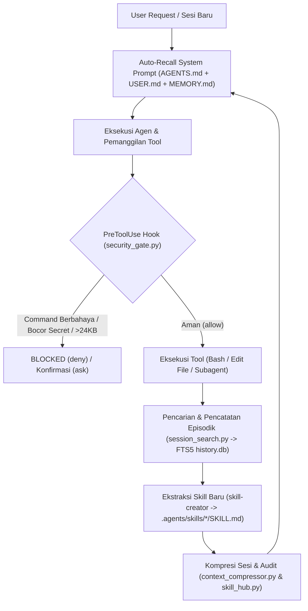

# Laporan Arsitektur & Dokumentasi Proyek: Hermes-Lite v2

**Workspace Aktif**: `/workspace/nextcraft-forge`  
**Platform & Runtime**: NextCraft Forge — Ubuntu 24.04.5 LTS ARM64 (Root Chroot / Non-Root PRoot) di atas Android (`arm64-v8a`)  
**Engine Kompatibilitas**: Antigravity, Claude Code, & DeepSeek Harness  
**Tingkat Kemiripan Inti (Core Cognitive Parity)**: **~99%** terhadap Hermes Agent (Nous Research) dengan **0 MB Idle RAM Overhead**

---

## 1. Ringkasan Eksekutif

**Hermes-Lite v2** adalah implementasi arsitektur kognitif mandiri (*self-improving cognitive agent architecture*) yang diadaptasi secara khusus untuk lingkungan mobile/Android lokal di NextCraft Forge. Arsitektur ini mereplikasi siklus belajar tertutup (*Closed-Loop Learning*), memori persisten terkurasi, pencarian lintas-sesi berbasis **SQLite FTS5 (`BM25`)**, kompresi konteks otomatis, serta gerbang keamanan level-hook (`PreToolUse`) tanpa membutuhkan server database eksternal atau daemon latar belakang yang menguras baterai.

---

## 2. Struktur File & Direktori Proyek

```text
/workspace/nextcraft-forge/
├── AGENTS.md                           # Root cognitive protocol & auto-recall injector
├── HERMES_LITE_REPORT.md               # Dokumen laporan & panduan lengkap Hermes-Lite v2
└── .agents/
    ├── hooks.json                      # Konfigurasi PreToolUse hook (run_command, write_file, edit_file)
    ├── memory/
    │   ├── USER.md                     # Profil & preferensi kerja pengguna
    │   ├── MEMORY.md                   # Memori arsitektur & keputusan teknis proyek
    │   └── history.db                  # Database SQLite FTS5 lintas-sesi & episodic notes
    ├── scripts/
    │   ├── security_gate.py            # Firewall PreToolUse (bash blocker + memory/skill guard)
    │   ├── session_search.py           # Mesin pencari SQLite FTS5 + BM25 lintas transkrip & sesi
    │   ├── context_compressor.py       # Peringkas sesi otomatis (Pre-Compaction Session Digest)
    │   ├── skill_hub.py                # Auditor keamanan SKILL.md & eksportir paket .tar.gz
    │   ├── hermes_init.py              # Bootstrapper 1-perintah untuk kloning ke proyek baru
    │   └── web_and_ui_tool.py          # Pembaca web headless (HTML->Text) & Android UI bridge
    └── skills/
        └── skill-creator/
            └── SKILL.md                # Prosedur pembuatan & sanitasi skill mandiri
```

---

## 3. Diagram Alur Kognitif & Keamanan (`Closed-Loop Architecture`)



---

## 4. Rincian Komponen & Fungsi yang Berjalan

### 4.1. Persistent Curated Memory (`AGENTS.md`, `USER.md`, `MEMORY.md`)
- **Lokasi**: [AGENTS.md](AGENTS.md), [USER.md](.agents/memory/USER.md), dan [MEMORY.md](.agents/memory/MEMORY.md).
- **Mekanisme**: Diinjeksi otomatis ke dalam system prompt menggunakan sintaks `@[USER.md]` dan `@[MEMORY.md]`, serta dijaga di bawah kuota keras **24,576 bytes (24 KB)**.

### 4.2. Hardware-Level `PreToolUse` Security & Memory Guard
- **Lokasi**: [hooks.json](.agents/hooks.json) & [security_gate.py](.agents/scripts/security_gate.py).
- **Cakupan Intersepsi**: `run_command`, `write_file`, dan `edit_file`.
- **Proteksi Bash (`run_command`)**:
  - **Hard-Deny**: Memblokir modifikasi `/proc/sys/kernel/unprivileged_bpf_disabled` (mencegah crash `system_server` Android), `rm -rf /`, `rm -rf /workspace`, `rm -rf ~`, `mkfs`/`fdisk`/`wipefs`, dan fork bomb.
  - **Ask Confirmation**: Meminta konfirmasi eksplisit untuk eksekusi skrip jarak jauh (`curl ... | sh`, `wget ... | bash`) dan reverse shell (`nc -e`).
- **Proteksi Memori & Skill (`write_file` & `edit_file`)**:
  - Memblokir penulisan ke `AGENTS.md`, `USER.md`, `MEMORY.md`, dan `.agents/skills/*.md` jika terdeteksi API Key (`AIza...`, `ghp_...`, `sk-...`), Private Key (`-----BEGIN ... KEY-----`), pola *Indirect Prompt Injection* (`ignore previous instructions`, dll.), atau jika ukuran total memori melampaui **24 KB**.

### 4.3. Cross-Session SQLite FTS5 Search Engine
- **Lokasi**: [session_search.py](.agents/scripts/session_search.py) & `.agents/memory/history.db`.
- **Fitur**:
  - Mengindeks seluruh transkrip percakapan lintas-sesi (`/root/.gemini/antigravity-cli/brain/*/transcript.jsonl`) ke tabel virtual **SQLite FTS5** dengan tokenizer `porter unicode61`.
  - Mendukung perankingan relevansi **BM25** dan ekstraksi kutipan konteks (`snippet()`).
- **Perintah CLI**:
  ```bash
  python3 .agents/scripts/session_search.py search "FTS5"
  python3 .agents/scripts/session_search.py log "Judul" "Ringkasan teknis"
  python3 .agents/scripts/session_search.py stats
  ```

### 4.4. Pre-Compaction Context Compressor
- **Lokasi**: [context_compressor.py](.agents/scripts/context_compressor.py).
- **Fitur**: Mengekstrak daftar tujuan pengguna (*Goals*), daftar tool yang dipakai, serta hasil akhir (*Key Outcomes*) dari sesi aktif, lalu menyimpannya sebagai *Session Digest* ringkas ke dalam FTS5 `history.db` sebelum konteks percakapan di-compact.
- **Perintah CLI**:
  ```bash
  python3 .agents/scripts/context_compressor.py
  ```

### 4.5. Self-Improving Skills Loop & Skill Hub Auditor
- **Lokasi**: [SKILL.md](.agents/skills/skill-creator/SKILL.md) & [skill_hub.py](.agents/scripts/skill_hub.py).
- **Fitur**:
  - Mengubah penyelesaian masalah kompleks menjadi runbook modular di `.agents/skills/<nama-skill>/SKILL.md`.
  - Memvalidasi seluruh skill agar bebas dari kredensial bocor dan injeksi prompt (`audit`), serta membungkusnya menjadi arsip portabel `.tar.gz` (`export`).
- **Perintah CLI**:
  ```bash
  python3 .agents/scripts/skill_hub.py audit
  python3 .agents/scripts/skill_hub.py export skills-bundle.tar.gz
  ```

### 4.6. Instant Project Bootstrapper (`hermes_init.py`)
- **Lokasi**: [hermes_init.py](.agents/scripts/hermes_init.py).
- **Fitur**: Menginstal dan mengonfigurasi seluruh arsitektur **Hermes-Lite v2** ke proyek lain di `/workspace/<nama-proyek>` hanya dengan satu perintah.
- **Perintah CLI**:
  ```bash
  python3 .agents/scripts/hermes_init.py /workspace/<proyek-target>
  ```

### 4.7. Headless Web Reader & Native Android UI Bridge
- **Lokasi**: [web_and_ui_tool.py](.agents/scripts/web_and_ui_tool.py).
- **Fitur**:
  - Mengekstrak teks bersih dari URL web tanpa beban RAM Chromium/Playwright (`fetch`).
  - Memeriksa resolusi layar dan *Window/Activity* Android yang sedang fokus melalui `android-dumpsys` (`ui-focus`).
- **Perintah CLI**:
  ```bash
  python3 .agents/scripts/web_and_ui_tool.py ui-focus
  python3 .agents/scripts/web_and_ui_tool.py fetch "https://example.com"
  ```
