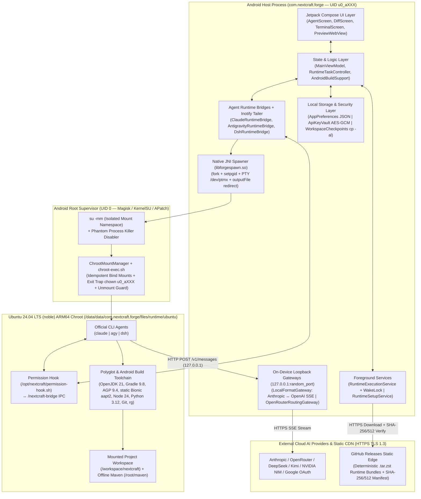

# FASE 1–2: Discovery & Architecture Decisions

> Bagian dari [ARCHITECTURE.md](../../ARCHITECTURE.md) (dipecah agar tiap file ≤ 1000 baris).

## FASE 1 — Discovery & Problem Scoping

### 1.1 Problem Statement Document

* **User Pain Point**:
  Developer Android dan full-stack engineer yang memiliki perangkat flagship Android ber-chipset ARM64 kencang (Snapdragon 8 Gen 2/3/Elite, RAM 8–16 GB) dan akses **Root (`Magisk` / `KernelSU` / `APatch`)** tidak dapat memanfaatkan performa hardware mereka secara penuh untuk menjalankan agen coding otonom (*Claude Code*, *Antigravity CLI*, *DeepSeek Harness*) sekaligus mengompilasi proyek Android (`Gradle assembleDebug`) secara lokal.
* **Current Solution & Mengapa Tidak Cukup**:
  1. **Pendekatan PRoot**: Sudah memiliki UI Chat, Diff Viewer, dan integrasi CLI Agent yang matang, tetapi menggunakan **`libproot.so`** (`ptrace` syscall interception) di atas **Ubuntu 20.04 (`focal`)**. Setiap syscall `stat()`, `openat()`, dan `execve()` selama kompilasi Gradle/Kotlin harus melewati *context switch* user-space berkali-kali, sehingga kompilasi menjadi **3x–8x lebih lambat** dibanding kernel native, dan pustaka `glibc 2.31` di Ubuntu 20.04 mulai usang untuk binary CLI modern.
  2. **Termux + `chroot` Manual**: Memberikan kecepatan native, tetapi sama sekali tidak memiliki UI Mobile IDE terpadu—tidak ada *Streaming Thinking/Tool Card UI*, tidak ada *Side-by-Side Diff & 1-Tap Undo/Keep Checkpoint*, tidak ada *Loopback API Format Translator* (`Anthropic` $\leftrightarrow$ `OpenAI`), dan tidak ada *1-Tap APK Build & Install*.
  3. **Cloud IDE (GitHub Codespaces / Replit)**: Wajib online 100%, memiliki latensi input tinggi saat sinyal seluler buruk, dan membebankan biaya sewa VM per jam.
* **Proposed Solution (**NextCraft Forge**)**:
  Membangun aplikasi Android native (`com.nextcraft.forge`) yang menggabungkan seluruh keunggulan UX dan orkestrasi multi-agen dari agent app berbasis PRoot dengan **Single-Engine Pure Root Chroot (`su -mm` + Linux kernel bind mounts)** di atas **Ubuntu 24.04 LTS (`noble`) ARM64**. Seluruh operasi file, eksekusi CLI Agent (`claude`, `agy`, `dsh`), dan kompilasi Gradle di `/workspace/nextcraft` berjalan dengan **100% kecepatan kernel native (0% overhead `ptrace`)**, dilengkapi *inotify streaming*, *hardlink workspace checkpoints*, *silent root APK installer*, dan *root package-scoped logcat debugger*.
* **Explicitly Out of Scope (v1.0)**:
  1. **Dukungan Non-Root / PRoot (`libproot.so`)**: Dihapus total demi menjaga kode C/JNI (`libforgespawn.so`) dan manajemen mount tetap ramping, cepat, dan bebas *dual-runtime bug*.
  2. **On-Device Local LLM Inference (`llama.cpp` / `GGUF`) & Model Fine-Tuning (`LoRA` / `QLoRA` / `RLHF`)**: Dihapus total agar seluruh RAM perangkat (8–16 GB) didedikasikan untuk daemon kompilasi `Gradle`/`Kotlin`/`aapt2` dan CLI Agent.
  3. **iOS App & Cloud Backend Milik Sendiri**: Aplikasi hanya menargetkan Android ARM64 (`arm64-v8a`) dengan arsitektur *100% Zero-Cloud Backend*.

---

### 1.2 Target User Persona

| Atribut | Persona 1: **Arka — Rooted Android Modder & Indie App Creator** | Persona 2: **Raka — On-the-Go Full-Stack & AI Engineer** | Persona 3: **Dina — Security Researcher & Open-Source Maintainer** |
| :--- | :--- | :--- | :--- |
| **Peran & Konteks** | Pengembang aplikasi Android independen yang mem-build dan menguji APK langsung di HP/tablet utama tanpa membawa laptop. | Engineer yang sering bepergian (commuter/traveler) dan perlu memperbaiki bug, me-review PR, serta men-deploy web/API menggunakan *Claude Code* / *Antigravity CLI*. | Peneliti keamanan & kontributor open-source yang membutuhkan lingkungan Ubuntu 24.04 ARM64 berakses root penuh dengan kontrol git/diff ketat. |
| **Technical Proficiency** | **5 / 5** (Paham `KernelSU`/`Magisk`, `adb`, `gradle`, `logcat`). | **4 / 5** (Mahir Git, Node.js, Python, dan prompt engineering AI Agent). | **5 / 5** (Mahir Linux internals, `chroot`, network debugging, dan bash). |
| **Primary Use Case & Frekuensi** | Menjalankan AI Agent untuk membuat fitur Jetpack Compose, menjalankan `assembleDebug` offline, menginstal APK 1-tap, dan membaca crash logcat (**Harian, 2–4 jam/hari**). | Menjalankan `Claude Code` dengan provider OpenRouter/DeepSeek untuk refactoring repo Git dan melihat live preview di WebView (**Harian, 1–2 jam/hari**). | Menguji kode di kontainer Ubuntu 24.04, menginstal paket `apt` modern, dan memeriksa setiap perubahan file AI lewat tab *Changes (Diff)* (**4–5x seminggu**). |
| **Device & Spesifikasi Tipikal** | POCO F5 / Xiaomi 14 / OnePlus 12 (Snapdragon 8 Gen 2/3, RAM 12 GB, UFS 4.0, Rooted dengan `KernelSU`). | Samsung Galaxy Tab S9 / Fold 5 (Snapdragon 8 Gen 2, RAM 12 GB, layar besar/lipat, Rooted dengan `Magisk`). | Google Pixel 8 Pro (Tensor G3, RAM 12 GB, Android 15/16, Rooted dengan `APatch`). |
| **Ekspektasi Latency** | Cold-start perintah Chroot **$\le 300\text{ ms}$**; streaming token pertama (**TTFB**) **$\le 1.5\text{ detik}$**; incremental APK build **$\le 25\text{ detik}$**. | Transisi antar tab (Chat $\leftrightarrow$ Diff $\leftrightarrow$ Preview) **$\le 16\text{ ms}$ (60/120 fps)**; streaming chunk UI **$\le 10\text{ ms}$**. | Ekstraksi bundel rootfs `.tar.zst` **$\le 45\text{ detik}$**; snapshot checkpoint sebelum agen jalan **$\le 100\text{ ms}$**. |
| **Penggunaan Offline?** | **Ya (Sering)**: Wajib bisa mengedit kode, menjalankan `git`, dan mengompilasi APK (`gradle --offline`) saat tanpa internet. | **Parsial**: Butuh internet untuk API LLM, tetapi butuh baca riwayat chat, diff kode, dan jalankan local dev server secara offline. | **Ya**: Memakai varian APK `offline` (dengan bundel `.tar.zst` tertanam) agar bisa setup kontainer tanpa internet. |

---

### 1.3 Competitive Analysis Matrix

| Kompetitor / Solusi | Core AI Capability | Streaming UX | Offline Support | Customization Level | Pricing Model | API Availability | Exploitable Gap untuk **NextCraft Forge** |
| :--- | :--- | :--- | :--- | :--- | :--- | :--- | :--- |
| **ChatGPT / Claude Official Mobile App** | Hanya Chat & Cloud Sandbox terbatas (tidak bisa akses filesystem proyek lokal atau build APK). | Sangat halus (native SSE), tetapi tidak menampilkan *inline file diff* atau kontrol proses lokal. | Hanya baca cache chat lama; tidak bisa eksekusi kode offline. | Rendah (terkunci pada 1 vendor, tidak bisa BYOK lintas provider). | Langganan ($20–$200/bln). | Tidak bisa menghubungkan API key kustom di dalam aplikasi mobile resmi. | Tidak memiliki kontainer Linux lokal, tidak bisa menjalankan CLI Agent di repo lokal, dan tidak bisa mem-build APK. |
| **Termux + `chroot` / `proot-distro`** | Tidak ada integrasi AI bawaan (user harus install & konfigurasi CLI manual di layar terminal kecil). | Hanya teks terminal ANSI mentah; sulit membaca diff file atau menyetujui *tool call* di layar sentuh. | Penuh (100% lokal), namun tanpa Offline Gradle Maven bundle siap pakai. | Sangat tinggi via skrip shell, tetapi UX mobile buruk. | Gratis (Open Source). | Bebas (konfigurasi manual via variabel `export` di `.bashrc`). | Tidak ada GUI Chat, tidak ada *Side-by-Side Diff + Undo Checkpoint*, tidak ada *LocalFormatGateway* (`Anthropic` $\leftrightarrow$ `OpenAI`). |
| **GitHub Codespaces / Replit Mobile** | AI Copilot / Replit Agent berjalan di server cloud. | Sering lag saat koneksi seluler tidak stabil; terminal berbasis WebSocket sering putus saat pindah aplikasi. | **Nol (0%)** — aplikasi mati total jika tidak ada koneksi internet. | Terbatas pada VM cloud yang disewa. | Pay-as-you-go / Langganan ($10–$50+/bln). | Mendukung secret environment di cloud. | Biaya bulanan mahal, wajib online terus-menerus, dan tidak bisa langsung menginstal serta men-debug APK di HP tempat aplikasi berjalan. |
| **Agent app berbasis PRoot** | Multi-Agent CLI (`Claude Code`, `Antigravity CLI`, `DSH`) + Loopback Gateway multi-provider. | Bagus (Thinking accordion, Tool cards, Diff viewer), namun pembacaan stream masih memakai *polling* `delay(80)`. | Sangat baik (Offline Maven repo & varian APK `offline`). | Tinggi (8 provider AI, OAuth & BYOK, custom base URL). | Gratis / BYOK (Bring Your Own Key / Subscription). | Mendukung `ANTHROPIC`, `OPENROUTER`, `OPENAI_CHAT`, `OPENAI_RESPONSES`. | **Masih memakai `PRoot` (`libproot.so`) di atas Ubuntu 20.04**, sehingga kompilasi Gradle lambat akibat overhead `ptrace`, proses root tidak terkelola, dan `glibc 2.31` sudah tua. |
| **NextCraft Forge (`com.nextcraft.forge`)** | **Multi-Agent CLI (`claude`, `agy`, `dsh`) berjalan di Pure Root Chroot Ubuntu 24.04 LTS ARM64.** | **Real-time `inotify` (`FileObserver`) stream (<2ms latency) + Native Diff Viewer + Root Logcat Crash Catcher.** | **100% Offline Gradle Build + Hardlink Checkpoints (`cp -al`) + Offline `.tar.zst` Bundles.** | **Penuh: Root Chroot penuh, 8+ AI Providers, API Key Pool, Custom System Prompts.** | **100% Gratis & Open/BYOK (User memakai API Key / OAuth sendiri tanpa biaya tengah).** | **Loopback Gateway lokal menerjemahkan Anthropic Messages API ke OpenAI/OpenRouter secara transparan.** | **Menutup gap performa PRoot: 3x–8x lebih cepat di I/O & kompilasi berkat Pure Kernel Chroot + Ubuntu 24.04 LTS.** |

---

### 1.4 KPI & Success Metrics

| Kategori | Metrik | Target (PRoot Baseline $\rightarrow$ **NextCraft Forge Target**) | Metode Pengukuran di Aplikasi |
| :--- | :--- | :--- | :--- |
| **Runtime Performance** | Cold-Start Chroot Execution Latency | $1.800\text{ ms}$ (PRoot) $\rightarrow$ **$\le 350\text{ ms}$ (P95)** | `ForgeMetricsTracker.measureChrootSpawnMs()` |
| **Streaming UX** | Local Stream Tail Latency (JSONL write $\rightarrow$ Compose UI state) | $80\text{ ms}$ (Polling) $\rightarrow$ **$\le 5\text{ ms}$ (P95 via `inotify`)** | Timestamp delta antara `FileObserver.MODIFY` dan `StateFlow` emission |
| **Build Speed** | Incremental Android APK Build (`assembleDebug --offline`) | $75\text{ detik}$ (PRoot) $\rightarrow$ **$\le 22\text{ detik}$ (P95)** | `AndroidBuildProgressTracker` stage duration timer |
| **Setup Speed** | Ekstraksi Bundel Rootfs (`core` + `android` ~950 MB `.tar.zst`) | $360\text{ detik}$ (JVM Tar) $\rightarrow$ **$\le 45\text{ detik}$ (Native `zstd \| tar`)** | `RuntimeInstaller` setup stopwatch |
| **Memory & Stability** | Host JVM Heap Usage & Crash-Free Session Rate | **$\le 220\text{ MB}$ RAM** & **$\ge 99.5\%$ Crash-Free** | `BoundedFileReads` (cap 256 KB) + `RootfsRepair` atomic swap guard |
| **Quality & Safety** | Checkpoint Undo Recovery Success Rate | **100% lossless rollback** dalam **$\le 150\text{ ms}$** | Verifikasi SHA-256 file sebelum & sesudah `WorkspaceCheckpoints.restore()` |

---

### 1.5 Cost, Quota & BYOK Architecture (Zero-Middleman Model)

Berbeda dengan aplikasi SaaS yang menarik biaya langganan untuk mem-proxy API di server mereka, **NextCraft Forge** mengadopsi arsitektur **100% Direct Bring-Your-Own-Key (BYOK) & Direct OAuth Subscription**:

1. **Tiga Mode Akses Provider (Tanpa Biaya Tengah)**:
   - **Tier A — Direct OAuth Subscription (`CLAUDE` Pro/Max & `Antigravity` Google OAuth)**: Pengguna login menggunakan akun langganan resmi mereka melalui alur PTY OAuth (`AntigravityAuthController.kt` & Claude OAuth). Token disimpan di dalam kontainer chroot (`/root/.claude` atau `/root/.gemini`) dengan izin ketat `0600`.
   - **Tier B — Multi-Key BYOK Pool (`ApiKeyVault.kt`)**: Pengguna dapat memasukkan **banyak API Key sekaligus** (*API Key Pool*) untuk satu provider (`Anthropic`, `OpenRouter`, `DeepSeek`, `Kimi`, `NVIDIA NIM`, `OpenCode Zen`, `Custom`). Jika Key #1 terkena HTTP `429 Rate Limit` atau kehabisan saldo (`402`/`quota_exceeded`), sistem secara otomatis merotasi ke Key #2 di dalam pool.
   - **Tier C — Free Model Discovery (`ProviderApiClient.discoverModels`)**: Untuk pengguna tanpa modal, fitur *Auto Model Discovery* memfilter model dengan harga `$0 / token` (`isFree == true`, seperti model `:free` di OpenRouter atau endpoint trial NVIDIA NIM).
2. **Local Token & Character Budget Guard (`RuntimeBridge.kt`)**:
   - Kuota dikendalikan langsung di perangkat pengguna melalui `recentWithinCharacterBudget(maxCharacters = 96_000)` dan pembatasan pembacaan log `BoundedFileReads.kt` ($256\text{ KB}$) sehingga agen tidak pernah membakar token secara tidak sengaja akibat membaca file log raksasa.

### Definition of Done Fase 1
- [x] Problem statement terdokumentasi dengan jelas (mengapa Pure Chroot Ubuntu 24.04 menggantikan PRoot Ubuntu 20.04).
- [x] 3 persona pengguna perangkat Android Rooted terdokumentasi lengkap dengan spesifikasi dan target latensi.
- [x] Competitive analysis matrix membandingkan 5 solusi nyata dan memetakan celah keunggulan NextCraft Forge.
- [x] KPI & metrik teknis kuantitatif ditetapkan (Cold-start $\le 350\text{ ms}$, stream tail $\le 5\text{ ms}$, incremental build $\le 22\text{ s}$).
- [x] Arsitektur BYOK, OAuth, API Key Pool rotation, dan Free Model Discovery terdokumentasi.

---

## FASE 2 — Architecture Decisions & Tech Stack

### 2.1 Architecture Decision Records (ADR-001 s.d. ADR-006)

#### ADR-001: Mobile Platform & Native Execution Bridge Selection
* **Status**: Accepted
* **Context**: NextCraft Forge harus mengelola terminal PTY (`/dev/ptmx`), melakukan `fork()`/`execve()` dengan pengaturan grup proses (`setpgid`), memantau perubahan file kontainer via kernel `inotify`, menjalankan reverse proxy HTTP/SSE lokal, dan memanggil `PackageInstaller` Android.
* **Options**:
  1. *Flutter (Dart)*: UI lintas platform yang baik, tetapi membutuhkan lapisan MethodChannel ganda (Dart $\rightarrow$ Kotlin $\rightarrow$ JNI C) yang menambah latensi streaming dan menyulitkan manajemen lifecycle `ForegroundService` Android.
  2. *React Native (TypeScript)*: Overhead JSI/Bridge tinggi saat menerima ribuan event JSONL per detik dari CLI Agent dan rawan kehabisan memori saat mem-parsing diff file besar.
  3. *Android Native (Kotlin 2.x + Jetpack Compose Material 3 + C11 JNI `libforgespawn.so`)*: Akses langsung (zero-overhead) ke API sistem Android, Java NIO `FileChannel`, `FileObserver`, dan JNI C11.
* **Decision**: Memilih **Option 3 — Android Native (Kotlin 2.x + Jetpack Compose + C11 JNI `libforgespawn.so`)**.
* **Consequences**:
  - **Positif**: Performa UI 60/120fps stabil, ukuran APK ramping, integrasi langsung dengan `AndroidKeyStore`, `ForegroundService`, dan `libforgespawn.so`.
  - **Negatif**: Hanya berjalan di Android (`arm64-v8a`), yang memang sesuai dengan target perangkat *Rooted Android*.

#### ADR-002: Container Runtime Engine Selection (Pure Root Chroot vs PRoot)
* **Status**: Accepted
* **Context**: CLI Agent (`Claude Code`, `Antigravity CLI`, `DeepSeek Harness`) dan toolchain kompilasi (`OpenJDK 21`, `Gradle 9.8`, `Node.js 24`, `Python 3.12`, `Git`) membutuhkan lingkungan filesystem Linux (`glibc`) standar di atas kernel Android.
* **Options**:
  1. *PRoot (`libproot.so`)*: Berjalan tanpa root menggunakan `ptrace` untuk memalsukan path syscall. Sangat lambat pada beban kerja I/O tinggi (seperti Gradle & `node_modules`) karena setiap syscall mengalami 2x *context switch* ke proses tracer.
  2. *Dual-Runtime (PRoot + Chroot)*: Menyimpan kode PRoot sekaligus Chroot. Membuat kode instalasi, ekstraksi, dan terminasi proses menjadi rumit serta membengkakkan ukuran native library (`talloc` + `proot` + `shmem`).
  3. *Single-Engine Pure Root Chroot (`su -mm` + Linux Kernel Mounts di atas Ubuntu 24.04 LTS `noble`)*: Menggunakan kapabilitas root (`CAP_SYS_ADMIN`, `CAP_SYS_CHROOT`) di dalam *mount namespace* terisolasi untuk melakukan `mount --bind` langsung di level kernel Linux dan masuk ke rootfs menggunakan syscall `chroot()`.
* **Decision**: Memilih **Option 3 — Single-Engine Pure Root Chroot (`su -mm` + Ubuntu 24.04 LTS ARM64)** dan menghapus `libproot.so` sepenuhnya.
* **Consequences**:
  - **Positif**: Kecepatan I/O dan kompilasi mencapai **100% kecepatan native kernel**, pustaka `glibc 2.39` (Ubuntu 24.04) mendukung semua binary AI Agent terbaru, dan kode C/JNI menyusut drastis menjadi hanya `forge_spawn.c`.
  - **Negatif**: Mewajibkan perangkat Android yang sudah di-root (`Magisk` / `KernelSU` / `APatch`) dan membutuhkan penanganan khusus untuk *permission ownership* (`chown $APP_UID`), *unmount guard* sebelum hapus folder, serta `GLIBC_TUNABLES=glibc.pthread.rseq=0`.

#### ADR-003: AI Provider & Multi-Agent CLI Harness Selection
* **Status**: Accepted
* **Context**: Aplikasi membutuhkan kemampuan agentic coding penuh (membaca file, mengedit kode, menjalankan bash/gradle, mencari referensi kode) dengan dukungan berbagai model LLM terbaik di pasar tanpa menguras RAM perangkat untuk inferensi lokal.
* **Options**:
  1. *On-Device Local LLM (`llama.cpp` / `GGUF`) + Fine-Tuning (`LoRA`)*: Menjalankan model 7B–8B di RAM HP. Mengonsumsi 5–8 GB RAM sehingga proses Gradle `assembleDebug` langsung mengalami `OutOfMemoryError` / *low-memory kill*, serta kualitas coding model 7B jauh di bawah model frontier.
  2. *Single Cloud Provider SDK*: Hanya mendukung 1 API (misal OpenAI saja) yang ditulis ulang dari nol di Kotlin.
  3. *Multi-Agent Official CLI Harness (`Claude Code`, `Antigravity CLI`, `DeepSeek Harness`) + Multi-Provider Cloud API*: Menjalankan binary CLI Agent kelas dunia langsung di dalam Ubuntu 24.04 Chroot, dan menghubungkannya ke 8+ provider (`Claude OAuth`, `Anthropic`, `OpenRouter`, `DeepSeek`, `Kimi`, `NVIDIA NIM`, `OpenCode Zen`, `Custom`) melalui gateway lokal.
* **Decision**: Memilih **Option 3 — Multi-Agent CLI Harness + Cloud API Providers** (Tanpa Local LLM & Tanpa Fine-Tuning).
* **Consequences**:
  - **Positif**: Mendapatkan kapabilitas agentic terbaik di dunia secara instan, mendukung fitur *in-container CLI update* tanpa perlu update APK, dan seluruh RAM HP bebas dipakai untuk kompilasi proyek.
  - **Negatif**: Membutuhkan koneksi internet saat berinteraksi dengan AI Agent (namun pengeditan manual, terminal Linux, diff viewer, dan kompilasi `gradle --offline` tetap berjalan 100% offline).

#### ADR-004: Local Subsystem & API Format Gateway Architecture
* **Status**: Accepted
* **Context**: Binary `Claude Code` (`@anthropic-ai/claude-code`) secara native hanya berbicara menggunakan protokol **Anthropic Messages API (`/v1/messages`)**, sedangkan pengguna ingin memakai berbagai model dari OpenRouter, DeepSeek, Kimi, NVIDIA NIM, atau OpenAI yang menggunakan protokol **OpenAI Chat Completions (`/v1/chat/completions`)** atau **OpenAI Responses API (`/v1/responses`)**.
* **Options**:
  1. *Cloud Proxy Server (FastAPI / NestJS di AWS)*: Membangun server cloud untuk menerjemahkan format API. Menimbulkan biaya server bulanan, latensi jaringan ekstra (HP $\rightarrow$ Server Kita $\rightarrow$ Provider AI), dan risiko privasi API key pengguna.
  2. *On-Device Loopback Format Gateway (`LocalFormatGateway.kt` & `OpenRouterRoutingGateway.kt`)*: Membuka `ServerSocket` lokal di `127.0.0.1:<random_port>` di dalam proses aplikasi Android yang menerjemahkan request `/v1/messages` dari `Claude Code` menjadi `/v1/chat/completions` atau `/v1/responses` secara *real-time streaming SSE*.
* **Decision**: Memilih **Option 2 — On-Device Loopback Format Gateway (`127.0.0.1`)**.
* **Consequences**:
  - **Positif**: **Zero-Cloud Cost ($0/bulan)**, latensi translasi $< 1\text{ ms}$ (loopback), dan API key pengguna tidak pernah meninggalkan perangkat kecuali langsung menuju endpoint resmi provider AI yang dipilih.
  - **Negatif**: Harus mengelola *lifecycle* `ServerSocket` lokal agar port selalu aktif selama sesi CLI Agent berlangsung.

#### ADR-005: Persistence, Secret Storage & Workspace Checkpointing
* **Status**: Accepted
* **Context**: Aplikasi perlu menyimpan riwayat chat, konfigurasi proyek, pool API key rahasia, serta membuat snapshot cepat dari seluruh pohon file proyek di `/workspace/nextcraft` sebelum AI Agent memodifikasi kode (untuk fitur *Diff Viewer* & *Undo/Keep*).
* **Options**:
  1. *SQLite/Room + Full File Copy (`copyTo`)*: Menyalin seluruh file proyek secara fisik setiap kali agen mulai bekerja. Pada proyek dengan ribuan file sumber, penyalinan fisik memakan waktu detik hingga menit dan mempercepat keausan flash UFS.
  2. *JSON `SharedPreferences` (`AppPreferences.kt`) + `AndroidKeyStore` AES-GCM (`ApiKeyVault.kt`) + Hardlink Snapshot (`cp -al` di `WorkspaceCheckpoints.kt`)*: Menyimpan metadata ringan di JSON terstruktur, mengenkripsi API key dengan kunci hardware `AndroidKeyStore` (`AES/GCM/NoPadding` 128-bit tag), dan membuat snapshot direktori proyek menggunakan **hardlink inode (`cp -al`)** + indeks hash.
* **Decision**: Memilih **Option 2 — JSON Preferences + AndroidKeyStore AES-GCM + Hardlink Snapshot (`cp -al`)**.
* **Consequences**:
  - **Positif**: Pembuatan snapshot proyek selesai dalam **$< 50\text{ ms}$** dengan **0 byte duplikasi blok disk** untuk file yang belum berubah, sementara kredensial pengguna terlindungi oleh chip TEE/StrongBox Android.
  - **Negatif**: Saat mengedit file di workspace, editor/agen tidak boleh menulis *in-place* pada inode hardlink yang sama tanpa memutus link, atau `WorkspaceCheckpoints` memvalidasi dengan *copy-on-write staging* untuk file kerja.

#### ADR-006: Rootfs Distribution & Safe Mount Lifecycle Strategy
* **Status**: Accepted
* **Context**: Di dalam mode Root Chroot, direktori sistem Android (`/dev`, `/dev/pts`, `/proc`, `/sys`, `/system`, `/apex`, `/vendor`, `/product`) dan direktori proyek (`/workspace/nextcraft`) di-*bind-mount* ke dalam folder `$ filesDir/runtime/ubuntu`. Jika fitur *Repair / Reset Rootfs* (`RootfsRepair.kt`) memanggil `File.deleteRecursively()` saat bind-mount masih aktif, ia akan menghapus node `/dev` atau file proyek pengguna!
* **Options**:
  1. *Naive Recursive Delete*: Langsung menghapus direktori `ubuntu/` seperti pada mode PRoot. **Sangat berbahaya** di mode Chroot karena akan merusak mount point host.
  2. *Safe Unmount Guard (`ChrootMountManager.unmountAll`) + Atomic Directory Swap (`.staging` $\rightarrow$ `.backup` $\rightarrow$ `ubuntu`) + Native `zstd -dc | tar -xf -`*: Mematikan semua proses grup Chroot terlebih dahulu, melakukan `umount -lf` secara berurutan dari path terdalam hingga terluar, memverifikasi `/proc/mounts` sudah bersih (0 mount tersisa di bawah `rootfs`), lalu melakukan ekstraksi native C `zstd` dan *atomic rename*.
* **Decision**: Memilih **Option 2 — Safe Unmount Guard + Atomic Directory Swap + Native `zstd` Extraction**.
* **Consequences**:
  - **Positif**: **100% aman dari kehilangan data host/workspace**, ekstraksi bundel 5x–10x lebih cepat dibanding loop `TarArchiveInputStream` di JVM, dan tahan terhadap kegagalan di tengah proses instalasi.
  - **Negatif**: Memerlukan verifikasi ketat terhadap `/proc/mounts` sebelum operasi penghapusan direktori apa pun diizinkan.

#### ADR-007: Non-Root Fallback Engine (PRoot) di Samping Pure Root Chroot
* **Status**: Accepted (merevisi ADR-002; Pure Root Chroot tetap mesin utama)
* **Context**: ADR-002 menolak PRoot karena kinerja dan menolak dual-runtime karena kompleksitas. Dua hal berubah: bundle Android 2026.10.1 memakai `aapt2`/`zipalign` **statis** (tidak butuh bind `/system`/`/apex`/`linker64`, satu-satunya bagian runtime yang mustahil tanpa root), dan ada permintaan menjalankan runtime di perangkat tanpa root.
* **Decision**: Tambahkan **satu** titik pemilihan mesin, `RuntimeEngines.detect()`: `su` tersedia → `CHROOT` (tidak berubah); tidak → `PROOT` bila APK membawa `libproot.so`; tidak keduanya → runtime tidak bisa dipasang. Kontrak supervisor dipertahankan: `proot-exec.sh` menerima argumen yang sama dengan `chroot-exec.sh` dan menghasilkan layout guest yang sama (`/workspace/<slug>`, `/pocketdev-bridge`, env Android). `prepareChrootShellCommand` hanya mengganti baris `exec`, dan ketiga peluncur (`NativeSpawnProcess`, `ChrootRunner`, `MainViewModel`) memakai `launchArgv()`. Operasi khusus root (`ensureUnmounted`, `reclaimOwnership`, `pm install` senyap, matikan phantom-process killer) menjadi *no-op*/fallback di `PROOT`, bukan cabang baru.
* **Biner**: `proot` 5.5.0 + `talloc` 2.4.3 dibangun statis (glibc, ARM64) oleh `scripts/runtime-bundles/build-proot-static.sh`, dikemas sebagai `app/src/main/jniLibs/arm64-v8a/libproot.so` (`useLegacyPackaging = true`) karena Android hanya mengizinkan exec dari `nativeLibraryDir`.
* **Consequences**: Build Gradle 2–4x lebih lambat di PRoot (ptrace); phantom-process killer tidak bisa dimatikan tanpa root; pemasangan APK hasil build memakai `PackageInstaller` biasa (ada dialog). Mode PRoot belum diuji di perangkat (sandbox CI tidak bisa menjalankan ptrace di bawah qemu-user). Rule Global nomor 2 direvisi.

---

### 2.2 System Architecture Diagram (C4 & Layered View)



---

### 2.3 API & IPC Contract Specification (OpenAPI 3.1.0 — On-Device Loopback Gateway)

Di **NextCraft Forge**, kontrak API berjalan di **Loopback Interface (`http://127.0.0.1:<dynamic_port>`)** milik `LocalFormatGateway.kt` dan `OpenRouterRoutingGateway.kt`. Berikut adalah spesifikasi OpenAPI 3.1.0 lengkap untuk gateway lokal tersebut:

```yaml
openapi: 3.1.0
info:
  title: NextCraft Forge On-Device Loopback Gateway API
  version: 1.0.0
  description: >
    Local-only (127.0.0.1) reverse proxy and protocol translator bridging
    Anthropic Messages API requests from CLI Agents inside Ubuntu 24.04 Chroot
    to OpenAI Chat Completions, OpenAI Responses, and OpenRouter upstream APIs.

servers:
  - url: http://127.0.0.1:{port}
    description: Ephemeral loopback socket bound to 127.0.0.1 only
    variables:
      port:
        default: "42150"

paths:
  /v1/messages:
    post:
      summary: Translate Anthropic Messages API request to Upstream Provider SSE Stream
      operationId: proxyAnthropicMessages
      parameters:
        - name: x-api-key
          in: header
          required: false
          schema:
            type: string
        - name: anthropic-version
          in: header
          required: false
          schema:
            type: string
            default: "2023-06-01"
      requestBody:
        required: true
        content:
          application/json:
            schema:
              $ref: '#/components/schemas/AnthropicMessageRequest'
      responses:
        '200':
          description: Anthropic-formatted Server-Sent Events (SSE) stream
          content:
            text/event-stream:
              schema:
                type: string
                example: |
                  event: message_start
                  data: {"type":"message_start","message":{"id":"msg_01","role":"assistant","model":"deepseek-chat"}}

                  event: content_block_delta
                  data: {"type":"content_block_delta","index":0,"delta":{"type":"text_delta","text":"Here is the fix..."}}

                  event: message_stop
                  data: {"type":"message_stop"}
        '401':
          description: Upstream Authentication Failed (triggers API Key Pool check)
        '413':
          description: Payload Exceeds MAX_REQUEST_BYTES (10 MB)
        '429':
          description: Upstream Rate Limit Exceeded (triggers API Key Pool rotation / OpenRouter fallback)

  /v1/messages/count_tokens:
    post:
      summary: Estimate input token count locally for Anthropic CLI compatibility
      operationId: countAnthropicTokens
      requestBody:
        required: true
        content:
          application/json:
            schema:
              $ref: '#/components/schemas/AnthropicMessageRequest'
      responses:
        '200':
          description: Estimated token count
          content:
            application/json:
              schema:
                type: object
                required: [input_tokens]
                properties:
                  input_tokens:
                    type: integer
                    example: 4820

components:
  schemas:
    AnthropicMessageRequest:
      type: object
      required: [model, max_tokens, messages]
      properties:
        model:
          type: string
          example: "anthropic/claude-sonnet-4.6"
        max_tokens:
          type: integer
          default: 8192
        stream:
          type: boolean
          default: true
        system:
          oneOf:
            - type: string
            - type: array
              items:
                type: object
        messages:
          type: array
          items:
            $ref: '#/components/schemas/AnthropicMessage'
        tools:
          type: array
          items:
            $ref: '#/components/schemas/AnthropicToolDefinition'

    AnthropicMessage:
      type: object
      required: [role, content]
      properties:
        role:
          type: string
          enum: [user, assistant]
        content:
          oneOf:
            - type: string
            - type: array
              items:
                type: object

    AnthropicToolDefinition:
      type: object
      required: [name, input_schema]
      properties:
        name:
          type: string
        description:
          type: string
        input_schema:
          type: object
```

---

### 2.4 Data Model & Filesystem Schema (On-Device Persistence)

Karena **NextCraft Forge** tidak menggunakan server PostgreSQL eksternal, skema data didefinisikan sebagai model data Kotlin (`Models.kt`) yang disimpan secara terenkripsi di `ApiKeyVault.kt` dan JSON terstruktur di `AppPreferences.kt`, dipadukan dengan skema direktori Linux di `/data/data/com.nextcraft.forge/files/`:

```kotlin
// app/src/main/java/com/nextcraft/forge/data/Models.kt
package com.nextcraft.forge.data

import kotlinx.serialization.Serializable

@Serializable
enum class AgentKind(val id: String, val binaryName: String, val displayName: String) {
    CLAUDE_CODE("claude", "claude", "Claude Code"),
    ANTIGRAVITY("antigravity", "agy", "Antigravity CLI"),
    DEEPSEEK_HARNESS("dsh", "dsh", "DeepSeek Harness")
}

@Serializable
enum class ApiProtocol {
    CLAUDE_LOGIN,       // Interactive OAuth session inside Chroot
    ANTHROPIC,          // Direct https://api.anthropic.com/v1/messages
    ANTHROPIC_GATEWAY,  // Custom Anthropic-compatible endpoint
    OPENROUTER,         // OpenRouter with provider order & allow_fallbacks
    OPENAI_RESPONSES,   // OpenAI /v1/responses translated via LocalFormatGateway
    OPENAI_CHAT         // OpenAI /v1/chat/completions translated via LocalFormatGateway
}

@Serializable
enum class ProviderId {
    CLAUDE, ANTHROPIC, LLM_ROUTER, DEEPSEEK, KIMI, OPENCODE_ZEN, NVIDIA_NIM, CUSTOM
}

@Serializable
data class ProviderProfile(
    val id: ProviderId,
    val protocol: ApiProtocol,
    val baseUrl: String,
    val primaryModel: String,
    val fastModel: String,
    val reasoningModel: String,
    val subagentModel: String,
    val openRouterProviderOrder: List<String> = emptyList(),
    val allowFallbacks: Boolean = true,
    val activeKeyIndex: Int = 0
)

@Serializable
data class WorkspaceProject(
    val id: String,
    val name: String,
    val hostPath: String,          // /data/data/com.nextcraft.forge/files/workspaces/<id>
    val guestMountPath: String = "/workspace/nextcraft",
    val createdAtEpochMs: Long,
    val lastOpenedEpochMs: Long,
    val activeAgent: AgentKind = AgentKind.CLAUDE_CODE
)

@Serializable
data class ProjectChat(
    val id: String,
    val projectId: String,
    val title: String,
    val agentKind: AgentKind,
    val agentSessionId: String? = null,
    val messages: List<ChatMessage> = emptyList(),
    val estimatedCharactersUsed: Int = 0,
    val createdAtEpochMs: Long,
    val updatedAtEpochMs: Long
)

@Serializable
data class ChatMessage(
    val id: String,
    val role: MessageRole, // USER, ASSISTANT, SYSTEM, TOOL
    val content: String,
    val thinkingText: String? = null,
    val toolCalls: List<ToolCallRecord> = emptyList(),
    val modelId: String? = null,
    val latencyMs: Long? = null,
    val timestampEpochMs: Long
)

@Serializable
enum class MessageRole { USER, ASSISTANT, SYSTEM, TOOL }

@Serializable
data class ToolCallRecord(
    val id: String,
    val name: String,
    val inputSummary: String,
    val outputPreview: String? = null,
    val status: ToolExecutionStatus // RUNNING, COMPLETED, DENIED, ERROR
)

@Serializable
enum class ToolExecutionStatus { RUNNING, COMPLETED, DENIED, ERROR }

@Serializable
data class CheckpointManifest(
    val projectId: String,
    val createdAtEpochMs: Long,
    val snapshotDir: String,       // /data/data/com.nextcraft.forge/files/checkpoints/<projectId>/latest
    val fileHashes: Map<String, FileEntryMeta>
)

@Serializable
data class FileEntryMeta(
    val relativePath: String,
    val sizeBytes: Long,
    val lastModifiedMs: Long,
    val sha256: String
)
```

**Skema Direktori Fisik di Perangkat (`/data/data/com.nextcraft.forge/files/`)**:
```text
/data/data/com.nextcraft.forge/
├── shared_prefs/
│   ├── nextcraft_preferences.xml       # Daftar proyek, riwayat chat JSON, preferensi UI & model
│   └── nextcraft_secrets.xml           # Pool API Key terenkripsi AES-256-GCM (AndroidKeyStore)
└── files/
    ├── runtime/
    │   ├── ubuntu/                     # Rootfs aktif Ubuntu 24.04 LTS (noble) ARM64
    │   │   ├── workspace/nextcraft/    # [BIND MOUNT] <- files/workspaces/<activeProjectId>
    │   │   ├── nextcraft-bridge/       # [BIND MOUNT] <- files/bridge/<sessionId>
    │   │   ├── dev/, proc/, sys/       # [KERNEL MOUNT] Virtual filesystems & PTY
    │   │   └── system/, apex/, vendor/ # [RO BIND MOUNT] Untuk eksekusi Bionic aapt2 Android
    │   ├── ubuntu.staging/             # Direktori sementara saat ekstraksi/update bundel .tar.zst
    │   ├── ubuntu.backup/              # Titik rollback otomatis jika update gagal (RootfsRepair)
    │   └── bin/chroot-exec.sh          # Wrapper su -mm + idempotent mount + chroot + chown trap
    ├── workspaces/<projectId>/         # Kode sumber asli proyek pengguna
    ├── checkpoints/<projectId>/latest/ # Hardlink snapshot (cp -al) untuk fitur Diff & Undo
    └── bridge/<sessionId>/             # IPC file stream (output.jsonl, permission.req, permission.res)
```

### Definition of Done Fase 2
- [x] 6 ADR lengkap ditulis dengan format Context $\rightarrow$ Options $\rightarrow$ Decision $\rightarrow$ Consequences.
- [x] Diagram arsitektur sistem (Mermaid) memvalidasi hubungan antara Host Android, Root Supervisor (`su -mm`), Ubuntu 24.04 Chroot, dan Loopback Gateway.
- [x] Spesifikasi OpenAPI 3.1.0 untuk On-Device Loopback Gateway (`/v1/messages` & `/v1/messages/count_tokens`) selesai.
- [x] Model data Kotlin (`Models.kt`) dan skema direktori fisik `/data/data/com.nextcraft.forge/` terdefinisi penuh.
- [x] Seluruh versi toolchain terkunci (`Kotlin 2.0.21`, `NDK 26.1.10909125`, `CMake 3.22.1`, `Ubuntu 24.04 noble`, `OpenJDK 17`).

---
